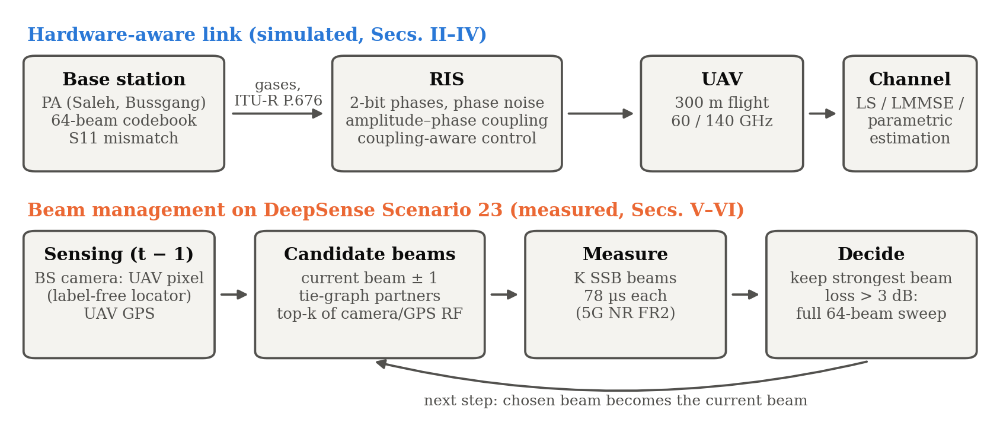
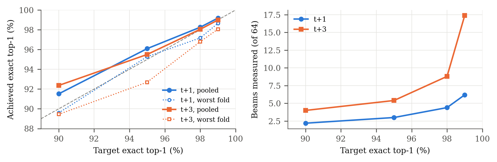
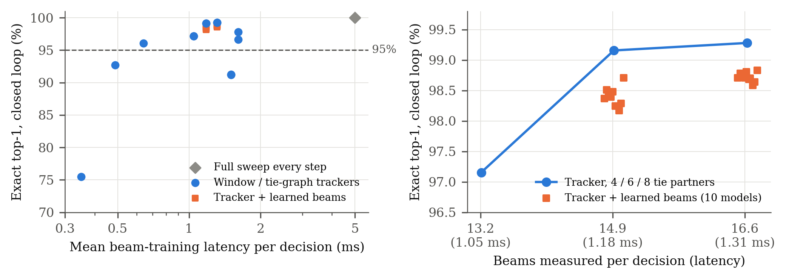
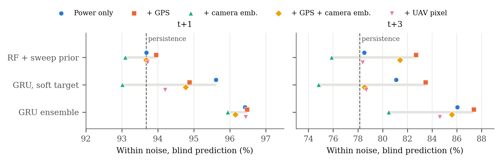
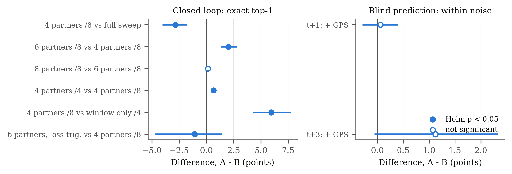
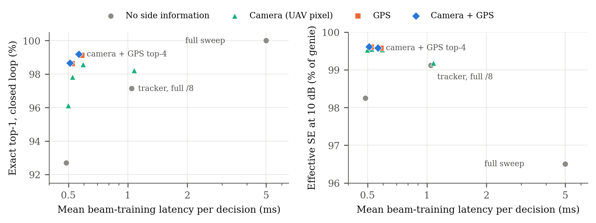

# Hardware-Aware AI-Assisted Beam Training, Tracking, and Channel Estimation for RIS-Assisted mmWave UAV Links

*Revised draft v3 (2026-10-30). Every number below is produced by the scripts in this repository; the
section "Reproducing this paper" at the end maps each table and figure to its script. All references
have been checked against their publishers' records.*

**Maavia**, Department of Computer Science, Institute of Space Technology (IST), Islamabad, Pakistan

---

## Abstract

Millimetre-wave (mmWave) and sub-terahertz links can give unmanned aerial vehicles (UAVs) multi-gigabit
connectivity, but narrow beams, high path loss and UAV mobility make beam management costly, and
practical hardware departs from the ideal models most reconfigurable intelligent surface (RIS) studies
assume. We present a hardware-aware framework for an RIS-assisted 60 GHz UAV link that models
transmitter power-amplifier (PA) distortion through the Bussgang decomposition, RIS phase quantization,
phase noise, amplitude–phase coupling and antenna mismatch, together with ITU-R P.676-13 gaseous
absorption. On this model we show that (i) impairments cost 7.8 dB of SNDR, dominated by amplitude–phase
coupling, so a realistic RIS needs about 2.25× more elements than an ideal one for full coverage of a
300 m flight; (ii) a position-parametric channel estimator reaches within 0.15 dB of perfect channel
knowledge with 64× fewer pilots than per-element LMMSE, and needs no pilots when a 100 ms Kalman
prediction is available; and (iii) predictive tracking delivers 99.3% of the ideal array gain at 500 ms
latency, whereas persistence delivers 63%. On real 60 GHz measurements (DeepSense 6G Scenario 23) we
show that exact blind beam prediction is bounded at 79% top-1 by measurement noise, and propose an
AI-assisted reduced beam training scheme with a learned beam-tie graph. Given full-sweep history it
selects the exact optimal beam 99.3% of the time at a 140 ms horizon (macro-F1 0.961 over all 56 beam
classes) and 99.1% at 0.4 s. Replayed in closed loop, where the system knows only the beams it measured,
tie-graph tracking selects the exact optimal beam 97.2–99.3% of the time with 1.05–1.31 ms of beam
training per decision instead of 5 ms, and per-flight tests confirm its spectral-efficiency gain over full
sweeps on 32 of 33 flights. Adding candidate beams from the UAV's GPS and from its position in the base
station's camera image, located without labels, lets the tracker drop periodic full sweeps: it then
selects the exact optimal beam 99.2% of the time (macro-F1 0.98 over beams with at least five samples)
with 0.56 ms per decision, better than the tie-graph tracker on 25 of 33 flights. Ten deep sequence models trained on measured-only data do not beat the tie
graph at equal measurement budget, and neither position nor camera features significantly improve blind
prediction, under sequence-level cross-validation.

**Index Terms**: mmWave, sub-THz, UAV, reconfigurable intelligent surface, beam training, beam
tracking, channel estimation, hardware impairments, deep learning.

---

## I. Introduction

Sixth-generation (6G) systems target mmWave and sub-THz bands for their large bandwidths [1], [2].
UAVs benefit directly, as aerial base stations, relays and sensing platforms, but high-frequency links
depend on narrow beams that a moving UAV quickly leaves. Exhaustive beam sweeping costs time that a
fast link cannot spare, which has motivated learning-based beam prediction from position and vision
[3], [4]. Reconfigurable intelligent surfaces (RISs) add a programmable reflection path when the direct
link is blocked [14], but real RIS hardware and transceivers are not ideal: transceiver distortion and
RIS phase noise change both performance and the optimal configuration [5], [6], and a practical RIS
element couples its reflection amplitude to its phase [15].

Three gaps motivate this work. First, RIS–UAV studies often pair idealised hardware with idealised
link budgets, which hides the hardware cost. Second, phase-tracking studies frequently score
controllers by per-element phase error, a metric that, as we show, says nothing about received power.
Third, beam prediction results on public datasets are easy to overstate: in the dataset we use, the
ground-truth beam is the argmax of the same power sweep often used as input, and consecutive samples
are nearly identical, so random splits leak.

**Contributions.**

1. A hardware-aware RIS–UAV link model with transmitter PA distortion (Bussgang SNDR), RIS phase
   quantization, phase noise, amplitude–phase coupling and S11 mismatch, on a full ITU-R P.676-13
   absorption model, with an impairment ablation and an RIS sizing rule (Sec. II, VI-A).
2. Hardware-aware control and estimation: a coupling-aware discrete phase search, an LMMSE estimator
   that inverts the hardware's realised training patterns, and a position-parametric estimator with an
   adaptive pilot budget (Sec. III, VI-B).
3. A predictive tracking study scored by delivered array gain, showing that position-based RIS control
   works at realistic sensor precision once the right metric is used (Sec. IV, VI-C).
4. On real 60 GHz measurements, a proof that exact blind beam prediction is noise-limited, a GRU trained
   on a soft power target, a learned beam-tie graph, and an AI-assisted reduced beam training scheme
   meeting ≥ 95% exact top-1 and macro-F1, conformal shortlists calibrated to a target accuracy, a
   closed-loop replay of every multi-sweep flight in which the system knows only what it measured, and a matched-budget
   comparison of ten deep sequence models against the tie graph in that loop, evaluated with
   sequence-level cross-validation and bootstrap confidence intervals (Sec. V, VI-D).
5. A label-free UAV locator for the base station's camera and a sensing-aided tracker that uses camera
   and GPS candidates instead of periodic sweeps, halving beam-training latency while raising exact
   top-1, with per-flight significance tests for every comparison (Sec. VI-D).

---

## II. System Model

Fig. 1 summarises the two parts of this work: a hardware-aware model of the RIS-assisted link (Secs.
II–IV), evaluated in simulation, and beam management on real 60 GHz measurements (Secs. V–VI), where
sensing proposes candidate beams that are then measured.

*Fig. 1. System overview. Top: the simulated hardware-aware link, from the BS power amplifier through the
impaired RIS to the UAV, and channel estimation. Bottom: the sensing-aided beam-management loop evaluated
on DeepSense Scenario 23; the camera and GPS of the previous step propose candidates, the base station
measures them with SSB beams, keeps the strongest, and sweeps all 64 beams only on beam loss.*

### A. Geometry

A fixed base station (BS) at (25, −15, 10) m serves a UAV through an N-element RIS whose direct path is
blocked. The RIS is a 32×32 uniform planar array with λ/2 spacing (8 cm aperture at 60 GHz), mounted on
a facade at (0, 0, 20) m with outward normal +x; it serves only the half-space in front of it. The UAV
flies at 10 m/s; trajectories cover straight, diagonal, climbing, descending, circular, helical and
waypoint paths, all in front of the panel.

### B. Channel

For element n at distance d, the BS→RIS and RIS→UAV coefficients are

h₁[n] = √G_BS · (λ / 4πd₁ₙ) · e^(−j2πd₁ₙ/λ)   · a(d₁ₙ) · √(G_e cos^q θ₁ₙ),   (1)

and likewise h₂[n] with the UAV gain G_UAV, where a(d) = 10^(−γd/20) is the gaseous-absorption amplitude
with γ from the ITU-R P.676-13 line-by-line model (44 O₂ and 35 H₂O lines) at 1013.25 hPa, 288.15 K and
7.5 g/m³ [8]; γ = 14.6 dB/km at 60 GHz. G_e = π is the gain of a (λ/2)² element [16], θ is measured
from the panel normal, q = 1.5, and the pattern is zero behind the panel. G_BS = 25 dBi and
G_UAV = 10 dBi; the transmit power is 20 dBm and the receiver noise is kTB·NF = −87 dBm (B = 100 MHz,
NF = 7 dB).

The received signal with reflection coefficients Γₙ is

y = Σₙ h₂[n] Γₙ h₁[n] · x + w.   (2)

With ideal hardware the optimal phases are φₙ = −∠(h₁[n] h₂[n]) and the array gain grows as N²
(verified: +12.04 dB per quadrupling of N).

### C. Hardware Impairments

**Transmitter PA.** A passive RIS has no amplifier; the PA sits at the BS. We apply Saleh's AM/AM and
AM/PM model [9] (α = 2.1587, β = 1.1517, α_φ = 4.0033, β_φ = 9.1040) to a complex Gaussian (OFDM-like)
input at 6 dB input back-off. By the Bussgang decomposition [17] the output is K·x + d, with d
uncorrelated with x, so a fraction ρ_d of the output power is distortion that travels through the
channel with the signal [18]:

SNDR = ρ_u P|h|² / (ρ_d P|h|² + σ²).   (3)

At 6 dB back-off ρ_u/ρ_d gives an SNDR ceiling of 13.3 dB, independent of link strength.

**RIS.** Commanded phases are quantized to b = 2 bits, perturbed by Gaussian phase noise (σ = 5°), and
realised with the phase-dependent amplitude of a practical element [15]:

β(φ) = (1 − β_min) · ((sin(φ − ϕ) + 1)/2)^κ + β_min,   β_min = 0.2, ϕ = 0.43π, κ = 1.6,   (4)

scaled by a reflection efficiency of 0.85.

**Antenna mismatch.** S11 = −10 dB at the BS and UAV ports gives a power transfer of 1 − |S11|² each.

Each impairment is switchable, so ideal and hardware-aware links are compared on identical geometry.

---

## III. Hardware-Aware Control and Channel Estimation

### A. Coupling-Aware Phase Selection

Because (4) ties amplitude to phase, the ideal phases are no longer optimal. For a common output phase ψ
the best realisable level for element n maximises Re(cₙ Γ(level) e^(−jψ)), with cₙ = h₁[n]h₂[n]; we
sweep 64 values of ψ and keep the best. The search is fully vectorised (≈3 ms for N = 1024).

### B. Per-Element Estimation: LS vs Hardware-Aware LMMSE

The RIS cycles through N Hadamard training patterns, each held for L pilot symbols. The *naive* LS
estimator assumes the commanded 0/π states were realised exactly. Under (4) the two states have
amplitudes 0.19 and 0.91, which biases LS. The *hardware-aware* estimator trains on the antipodal state
pair with the largest reflected energy, models the realised coefficients through (4), and applies
LMMSE with an i.i.d. prior; because PA distortion is signal-dependent, only its average power enters the
noise model.

### C. Position-Parametric Estimation

The BS and RIS are fixed, so c(p) = h₁ ⊙ h₂(p) depends only on the UAV position p. Beyond the Fresnel
distance (≈5 m here) the pilots constrain the direction of p sharply and its range weakly. Starting from
a prior p₀, the RIS transmits M random realisable patterns A, and the receiver estimates the direction
by maximising the likelihood under an unknown complex gain,

p̂ = argmax_p |yᴴ A c(p)|² / ‖A c(p)‖²,   (5)

over direction cosines on a coarse grid finer than the beam width, then a fine grid. The RIS is then
configured from c(p̂) with the search of Sec. III-A.

**Adaptive pilot budget.** The search succeeds when the matched-filter pilot SNR M·L·SNR_coh/N exceeds a
threshold; SNR_coh is predicted from p₀ and the known geometry. With M = 64 we choose L to reach a
threshold of 128, selected on random seeds separate from those reported. If the prior's angular
uncertainty is already below one eighth of the beam width, no pilots are sent.

---

## IV. Predictive RIS Tracking

The RIS must be configured for where the UAV will be once measurement, computation and control latency
have passed. We predict the position h steps ahead (h·10 ms, h ∈ {1, 10, 50}) from RTK-class position
measurements (σ = 2 cm per axis) with four predictors: persistence, constant-velocity extrapolation, a
constant-velocity Kalman filter [13] whose acceleration PSD is tuned on training trajectories, and a
ridge regressor on an 8-sample window trained on 60 random trajectories. All predictors see the same
noisy measurements, and the nine designed trajectories are held out.

**Metric.** Mean absolute per-element phase error counts a phase offset common to all elements as error,
but such an offset leaves |Σₙ cₙ e^(jφ̂ₙ)| unchanged. We therefore score the fraction of the ideal
coherent gain delivered at the true position:

G = |Σₙ cₙ e^(jφ̂ₙ)|² / (Σₙ |cₙ|)².   (6)

---

## V. AI Beam Prediction on Real Measurements

### A. Dataset and Evaluation Protocol

DeepSense 6G Scenario 23 [10] provides 11,387 samples of 64-beam received-power sweeps at 60 GHz from a
drone flight campaign, organised into 35 flight sequences, with the optimal-beam index as label (56
classes in use). Three properties of the data shape the protocol:

1. **The label is the argmax of the sweep** for all 11,387 samples, so predicting the current beam from
   the current sweep is trivial (100% by argmax). Every task below predicts the beam at time t + h from
   sweeps up to time t.
2. **Consecutive samples are near-duplicates** (≈7 Hz). All models are evaluated with GroupKFold(5)
   over flight sequences, so a test sequence is never seen in training.
3. **Near-ties are noise.** In 75.3% of sweeps the best and second-best beams are within 0.25 dB (they
   are adjacent in 90.6%), while the same beam's power changes by a median 0.18 dB between consecutive
   sweeps.

Comparisons between two methods are tested per flight, the unit of replication, because samples within
a flight are strongly correlated: we report the pooled difference with a 95% CI from a paired bootstrap
over flights (5000 resamples) and the Wilcoxon signed-rank test on per-flight differences, Holm-corrected
within each family of comparisons.

### B. Blind Prediction

A two-layer GRU (hidden size 128) reads the last 8 sweeps (dB relative to peak) and the sampling gaps,
and outputs beam logits added to a learned multiple of the last sweep, so that it learns a residual over
persistence. Because near-tied labels are noise, we train against a **soft target**,
softmax(P_{t+h}/0.5 dB), the measured power of the future sweep, rather than its argmax; a hard-label GRU
is the ablation. Early stopping uses held-out training sequences. Our final predictor averages the
log-probabilities of three such GRUs (different seeds) trained with **beam-axis augmentation**: each
batch is shifted by up to ±3 beams and mirrored with probability 0.5, identically for history, last
sweep and target, with vacated edge beams set to the row's floor rather than wrapped. A UAV at a slightly
different angle sees a shifted beam pattern, so this adds plausible examples of rarely visited beams.
Random-forest and extra-trees baselines use the last 3 sweeps.

**Noise ceiling.** As an upper bound for any causal predictor of the exact label, a non-causal oracle
that averages the sweeps *before and after* the target sweep reaches only **79.0% exact top-1 and 0.59
macro-F1**.

### C. AI-Assisted Reduced Beam Training

A deployed link does not have to choose blind: it can measure a few candidate beams at time t + h and
keep the strongest. The predictor ranks the beams; the system measures the top K and keeps the best;
the result is scored against the **full 64-beam ground truth** on exact top-1 and macro-F1, with an
overhead of K/64 of a full sweep. Shortlists are produced from out-of-fold GRU scores and compared with
non-learned rankings (the last sweep's strongest beams; a window around the last best beam). The fused
ranking adds the z-scored GRU log-probabilities to the z-scored last sweep with equal weight. An
adaptive variant measures the smallest set whose GRU probability reaches τ.

**Learned tie graph.** The strong beams of this codebook are not contiguous: beams 27, 28, 32, 33 and 38
are often within 0.1 dB of each other, so a search around the last best beam misses the true best. For
each beam b, the training flights give the beams most often within 1 dB of the best when b was the best.
Two schemes use it, following the coarse/refine split of 3GPP beam management. *Two-round*: measure the
first K₁ ranked beams, then the M top graph partners of the measured winner; if the best measured power
is still more than 3 dB below the last sweep's peak, the beam is treated as lost and the remaining beams
are swept. *Burst*: append the graph partners of the two *predicted* best beams to the first K ranked
beams and measure them all at once, avoiding a report round trip.

**Latency model.** We use 5G NR FR2 timing at 120 kHz subcarrier spacing, where up to 64 SSB beams fit in
a 5 ms half-frame [22]: 78 µs per beam measurement, plus 1 ms for each extra report round trip. A full
sweep costs 5 ms. GRU inference (0.5 ms for one model and 1.4 ms for the 3-model ensemble at batch size 1
on a laptop CPU) is not on the critical path: the shortlist for t + h is computed from sweep t, during
the ≈140 ms before t + h.

**Operating points by nested cross-validation.** For each held-out fold, the setting (K, τ, or K₁, M and
the fallback) is the lowest-latency one meeting 95% on both exact top-1 and all-class macro-F1 over the
other four folds, and is then applied unchanged to the held-out fold. The tie graph is always fitted on
folds other than those it is scored on, including inside this selection. 95% confidence intervals come
from 500 bootstrap resamples of whole flight sequences.

**Conformal shortlists.** A measured set returns the exact optimal beam if and only if that beam is in
the set, so set coverage equals exact top-1. We calibrate the set size by split conformal prediction
[23]: on four folds, the score is the true beam's rank in the GRU ranking, and the threshold is its
⌈(n + 1)(1 − α)⌉-th smallest value; the fifth fold is the test. Adaptive prediction sets [24] use the
GRU's cumulative probability instead. Samples within a flight are correlated and flights differ, so the
exchangeability behind the guarantee holds only approximately; we report the coverage of every held-out
fold.

**Closed-loop replay.** The schemes above build each shortlist from full sweeps of earlier steps, which
a system measuring only K beams per step never has. We therefore replay every flight with more than one sweep (33 of 35) step by step with
policies that know only the beams they measured: the current beam, its ±1 index neighbours and its M
strongest tie-graph partners (fitted on other folds' flights), with a full sweep every N steps or only
on beam loss (best measured power more than 3 dB below the current beam's last value). The effective
spectral efficiency over each interval is (1 − T_train/T) times the mean of log2(1 + SNR₀ p_used/p_best)
at the interval's start and end, using measured powers, so beam ageing is measured, not modelled. The
dataset's powers are unitless, so SNR₀, the best beam's SNR, is a nominal operating point.

**Learned closed-loop tracking.** To test whether a learned model helps once only measured beams are
known, we log each flight under the tie-graph tracker (±1 window, four partners, full sweep every 8
steps). Each logged step holds the measured beams' power in dB relative to the strongest measured beam,
−20 dB for unmeasured beams, the measurement mask, a full-sweep flag and the time gap. A model reads
the last W steps and predicts the next step's best beam; the training target is the next recorded full
sweep (soft, 0.5 dB temperature, or hard), available offline only. In deployment the tracker measures
its usual set plus the model's top k ∈ {2, 4} beams not already in it, and the model's next input is
built from what was measured. The baseline at the same budget is the tracker with k more tie partners.
We compare a GRU, an LSTM, a dilated temporal CNN, a Transformer encoder and an MLP over the window, and
GRU variants in hidden size (64, 128), learning rate (10⁻³, 3·10⁻⁴), window (4, 8, 16) and target
(soft, hard); all are trained with AdamW, batch 128, early stopping on validation flights. The headline
configuration is selected by top-4 accuracy on validation flights inside the training folds. Inference
latency is the median of 300 batch-1 forward passes on one thread of a laptop CPU, in fp32 and with
dynamic int8 quantization; it is not a measurement on embedded hardware.

---

## VI. Results

### A. Link Budget and Hardware Impairments

With ideal hardware the SNR is 15.8 dB at 20 m and 8.8 dB at 50 m. At 50 m the combined impairments cost
**7.83 dB** (Fig. 2): amplitude–phase coupling 5.51 dB, PA nonlinearity 1.46 dB, S11 mismatch 0.92 dB,
2-bit quantization 0.91 dB and phase noise 0.03 dB.

*Fig. 2. SNDR penalty of each impairment alone and combined, UAV at 50 m.*

**Note on the first draft.** Without antenna and element gains and with an 8×8 (2 cm) RIS, the SNR is
−43.2 dB at 20 m, the value reported in our earlier draft; it reflects missing gains, not sub-THz
propagation. The same cause explains the earlier −170 dBm at 140 GHz: with gains included, an 8×8 RIS
receives −115.9 dBm at 140 GHz at 50 m, and the N² law holds at both carriers (Table I).

*Table I. Received power at 50 m, ideal hardware (dBm).*

| RIS | 60 GHz | 140 GHz |
|---|---|---|
| 8×8 | −102.3 | −115.9 |
| 16×16 | −90.2 | −103.8 |
| 32×32 | −78.2 | −91.8 |
| 64×64 | −66.2 | −79.7 |

**Phase resolution and coupling strength.** Coupling-aware selection (Sec. III-A) gains more as more
realisable states become available: 0.55, 0.92 and 1.01 dB at 2, 3 and 4 bits, and nothing at 1 bit
(−0.06 dB). No measured coupling curve for a 60 GHz element is available to us, so we sweep its strength
(Table II). The total penalty ranges from 2.9 dB without coupling to 7.8 dB at β_min = 0.2; the
conclusions below hold across this range, and the gain of coupling-aware control shrinks as coupling
weakens.

*Table II. SNDR penalty vs coupling strength, UAV at 50 m, 2-bit phases.*

| β_min | 0.2 | 0.4 | 0.6 | 0.8 | 1.0 (none) |
|---|---|---|---|---|---|
| Naive control (dB) | 7.83 | 6.22 | 4.92 | 3.84 | 2.93 |
| Coupling-aware (dB) | 7.28 | 5.98 | 4.83 | 3.80 | 2.90 |

Impairments change how large the RIS must be (Fig. 3). Over a 20 → 320 m flight, a 64×64 RIS gives 100%
availability (SNDR ≥ 0 dB) with ideal hardware but only 57% with realistic hardware; a 96×96 RIS
(24 cm) restores 100%. The hardware cost is therefore about 2.25× in element count.

*Fig. 3. Link availability over the flight versus RIS size. Left: 60 GHz, ideal versus realistic hardware with coupling-aware control. Right: 140 GHz with D-band transceiver hardware, realistic RIS, for receiver noise figures of 6, 7 and 10 dB (dashed: ideal hardware).*

**60 vs 140 GHz at equal aperture.** With the same 8 cm panel (32×32 at 60 GHz, 75×75 at 140 GHz) and the
same transceiver hardware, 140 GHz performs slightly better (ideal SNR 16.6 vs 15.8 dB at 20 m; 47.5% vs
34.4% availability): it avoids the 60 GHz oxygen line (0.69 vs 14.6 dB/km) and fits 5.5× more elements in
the same area. With published D-band hardware (about 20 dBm PA saturation [20], hence 14 dBm average at
6 dB back-off) and a conservative 10 dB receiver noise figure the link loses about 9 dB, and the RIS must
grow to 32 cm (300×300 elements) for full availability with realistic impairments, against 24 cm at
60 GHz (Table III). The receiver noise figure is the decisive assumption: D-band SiGe LNAs alone measure
4.8–6.1 dB [21], and with a 6 dB receiver 24 cm suffices at 140 GHz as well (7 dB: 28 cm). At sub-THz,
transceiver hardware, not propagation, sets the RIS size, and the panel spans 24–32 cm across that range.

**Sensitivity to assumed values.** Three further inputs are literature values or assumptions rather than
measurements, so we vary each. (i) The Saleh coefficients are Saleh's travelling-wave-tube fit; how much
they matter depends on how hard the PA is driven. From 3 to 12 dB input back-off the PA alone costs
2.6 to 0.4 dB at 50 m, and all impairments with coupling-aware control 7.8 to 6.9 dB, so amplitude–phase
coupling remains the dominant impairment at every operating point. (ii) For element obliquity exponents
from 0 (isotropic) to 2, the 60 GHz RIS needs 64×64 elements for full coverage with ideal hardware and
96×96 (24 cm) with realistic hardware, the same 2.25× as with the default 1.5; only a strongly directive
element (exponent 3) changes it, to 80×80 and 112×112 (1.96×). (iii) Around the assumed 14 dBm D-band
average power, 11 and 17 dBm move the 140 GHz panel to 36 and 28 cm (NF 10 dB).

*Table III. Availability (%) over the flight at 140 GHz with D-band hardware (14 dBm average transmit
power), by RIS size and receiver noise figure (NF).*

| RIS (aperture) | 75×75 (8 cm) | 150×150 (16 cm) | 188×188 (20 cm) | 225×225 (24 cm) | 263×263 (28 cm) | 300×300 (32 cm) |
|---|---|---|---|---|---|---|
| Ideal hardware, NF 10 dB | 13.1 | 68.9 | 100 | 100 | 100 | 100 |
| Realistic, coupling-aware, NF 10 dB | 1.6 | 27.9 | 45.9 | 67.2 | 95.1 | 100 |
| Realistic, coupling-aware, NF 7 dB | – | 41.0 | 67.2 | 98.4 | 100 | 100 |
| Realistic, coupling-aware, NF 6 dB | – | 45.9 | 75.4 | 100 | 100 | 100 |

### B. Channel Estimation

Naive LS saturates at about −7.5 dB NMSE because of the coupling bias, whereas hardware-aware LMMSE keeps
improving with pilot length (−11.1 dB at 20 m with 4096 symbols per pattern) and is never worse. In
closed loop (estimate, configure, measure SNDR), the hardware-aware pipeline beats the naive one at
every distance and pilot length, by 0.4–1.2 dB.

Per-element estimation, however, scales poorly with range. The parametric estimator (Table IV) reaches
perfect-CSI SNDR to within 0.15 dB at 20–100 m with 64×1024 = 65k pilot symbols, against 4.2M for
per-element LMMSE, which still falls 1.6 dB short at 100 m. A 5 m GPS prior alone is useless
(−23 to −31 dB) because its error exceeds the beam width. With the adaptive budget (Table V), the
estimator delivers 96.5–100% of perfect-CSI SNR on average at every range and prior, and needs no pilots
when the 100 ms Kalman prediction is used as prior.

*Table IV. SNDR (dB) from a 5 m GPS prior.*

| UAV at | Perfect CSI | GPS only | Parametric, 65k pilots | Per-element LMMSE, 4.2M pilots |
|---|---|---|---|---|
| 20 m | 7.47 | −23.7 | 7.47 | 7.32 |
| 50 m | 1.50 | −31.4 | 1.49 | 1.07 |
| 100 m | −4.75 | −22.9 | −4.90 | −6.33 |

*Table V. Adaptive parametric estimation: mean (worst of 10) % of perfect-CSI SNR, and pilot symbols.*

| UAV at | GPS prior (5 m) | Kalman, 500 ms (31 cm) | Kalman, 100 ms (5 cm) |
|---|---|---|---|
| 20 m | 97.4 (90.9), 6k | 97.3 (93.4), 4k | 99.5 (98.6), 0 |
| 50 m | 98.4 (95.9), 31k | 98.5 (95.8), 33k | 99.9 (99.4), 0 |
| 100 m | 96.9 (93.5), 131k | 96.8 (91.7), 131k | 99.9 (99.6), 0 |
| 200 m | 96.5 (86.3), 524k | 99.4 (98.5), 0 | 100.0 (99.8), 0 |

### C. Predictive Tracking

Every predictor shows a mean absolute phase error of 89–92°, the value an unaligned phase profile would
give, yet the delivered gain (6) ranges from 63% to 100% (Table VI, Fig. 4). The phase-error metric
therefore cannot rank controllers. Prediction matters at realistic latencies: at 500 ms the Kalman
filter delivers 99.3% of the ideal gain (5th percentile 97.4%), the learned ridge predictor 98.8%,
constant velocity 71.4% and persistence 63.0%. All predictors run in under 0.1 ms per step.

*Table VI. Delivered array gain (%) and position RMSE (cm), held-out trajectories.*

| Horizon | Persistence | Constant velocity | Kalman CV | Ridge (learned) |
|---|---|---|---|---|
| 10 ms | 99.9 / 10.4 | 99.9 / 7.7 | **100.0 / 2.0** | 100.0 / 2.7 |
| 100 ms | 94.0 / 97.9 | 97.2 / 51.9 | **99.98 / 5.2** | 99.9 / 8.2 |
| 500 ms | 63.0 / 488 | 71.4 / 250 | **99.3 / 30.7** | 98.8 / 41.4 |

*Fig. 4. Delivered array gain versus prediction horizon (held-out trajectories); the Kalman and the learned ridge predictors overlap above 98.8%.*

### D. Beam Prediction on Scenario 23

**Blind prediction** (Table VII). At t + 1 (≈140 ms) the augmented GRU ensemble selects a beam within the
0.25 dB noise margin 96.4% of the time (class-balanced 91.7%), has 96.1% top-3 accuracy, and delivers
99.1% of the optimal received power. Its exact top-1 is 72.1% against the 79.0% oracle ceiling. At t + 3
it reaches 86.0% within noise and 96.8% power ratio. Trained on hard labels, a single GRU falls below
persistence at t + 3; the soft target makes it competitive, and augmentation with ensembling makes it
the best model on every metric at both horizons, including blind macro-F1 at t + 3 (0.28 vs 0.26).

*Table VII. Blind beam prediction (no beam measured at the predicted time), GroupKFold over 35 sequences.
Exact top-1 and macro-F1 are bounded by measurement noise: the last row is a non-causal oracle that sees
the sweeps on both sides of the predicted one. In parentheses: exact top-1 as % of that bound.
Decisive / near-tie: exact top-1 on samples whose best beam leads the runner-up by more than the 0.25 dB noise floor (25% of
samples) and on the other 75%. The
deployed task, which measures a few beams, is in Tables VIII–X and XIV (best schemes: exact top-1 about 99%).*

| Horizon | Model | Within noise | Balanced within noise | Top-3 | Power ratio | Exact top-1 | Macro-F1 | Decisive | Near-tie |
| --- | --- | --- | --- | --- | --- | --- | --- | --- | --- |
| t+1 | Persistence | 93.7 | 86.3 | 94.5 | 98.6 | 69.2 (88%) | 0.45 | 89.8 | 62.3 |
| t+1 | RF + sweep prior | 93.7 | 86.7 | 94.9 | 98.6 | 70.4 (89%) | 0.41 | – | – |
| t+1 | GRU, hard label | 93.7 | 82.3 | 94.6 | 98.6 | 70.9 (90%) | 0.41 | 93.1 | 63.5 |
| t+1 | GRU, soft target | 95.6 | 89.3 | 95.1 | 98.9 | 70.9 (90%) | 0.45 | **94.7** | 63.0 |
| t+1 | **GRU ens., augmented** | **96.4** | **91.7** | 96.1 | **99.1** | 72.1 (91%) | 0.48 | 94.1 | 64.7 |
| t+1 | GRU ens. + sweep, fused | 96.3 | 90.9 | **96.3** | **99.1** | **72.4 (92%)** | **0.49** | 94.0 | **65.3** |
| t+3 | Persistence | 78.1 | 66.1 | 80.3 | 93.7 | 53.3 (67%) | 0.26 | 69.2 | 47.9 |
| t+3 | GRU, hard label | 73.2 | 57.9 | 80.6 | 93.1 | 49.5 (63%) | 0.21 | 73.6 | 41.5 |
| t+3 | GRU, soft target | 81.1 | 65.8 | 84.8 | 95.5 | 55.3 (70%) | 0.24 | 78.6 | 47.5 |
| t+3 | **GRU ens., augmented** | **86.0** | **75.5** | **86.9** | **96.8** | 56.7 (72%) | 0.28 | **78.7** | 49.4 |
| t+3 | GRU ens. + sweep, fused | 85.2 | 74.7 | 86.5 | 96.5 | **57.3 (73%)** | **0.29** | 76.6 | **50.9** |
| any | *Noise bound (non-causal oracle)* | – | – | – | – | *79.0 (100%)* | *0.59* | – | – |

**Where blind exact prediction fails** (Table VII, `blind_prediction_analysis.py`). Exact top-1 depends
almost entirely on whether the label is decided by the channel or by noise. On the 25% of samples whose
best beam leads by more than the 0.25 dB noise floor, the GRU ensemble predicts the exact beam 94.1% of
the time at t + 1 (95% flight-bootstrap CI 91.7–95.9%) and 78.7% at t + 3 (71.4–84.9%). On the other 75%,
two or more beams are equal within the noise, the label is a coin toss among them, and every model,
including persistence, is near 62–65% at t + 1. Blind exact top-1 therefore cannot approach 95% on this
data, while the measured schemes below can. Fusing the GRU ensemble with the last sweep, with the weight
chosen on the other folds' flights, adds 0.3 points of exact top-1 at t + 1 (72.4%) and 0.6 at t + 3
(57.3%), and macro-F1 by 0.004 and 0.012, at the cost of 0.1–0.8 points of within-noise accuracy: the
remaining gap to the 79% bound is the information in future sweeps that no causal predictor has.

**Reduced beam training** (Table VIII, Fig. 5). Measuring a handful of predicted beams resolves the
near-ties that blind prediction cannot. At t + 1, the GRU ensemble with the tie graph selects the exact
optimal beam 99.3% of the time with macro-F1 0.961 over all 56 classes, measuring 7 of 64 beams in
0.55 ms; the 95% interval of exact top-1 lies above 95%. At t + 3, the same scheme reaches 99.1% exact
top-1 and macro-F1 0.974 over beams with at least five samples, with 11.7 beams. The single-burst
variant reaches 98.9% / 0.971 in 1.22 ms. Every scheme in Table VIII also keeps at least 99.5% of
decisions within the 0.25 dB noise floor and at least 99.8% of the best beam's power.

*Table VIII. Reduced beam training (open-loop: full-sweep history assumed), nested-CV operating points,
scored against the full-sweep ground truth [95% CI over sequences]. Latency: beam-training time under 5G NR FR2 timing (full sweep: 5 ms).
Macro-F1 ≥ 5: over beam classes with at least five samples.*

| Horizon | Shortlist | Beams | Latency (ms) | Exact top-1 (%) | Macro-F1 (56 classes) | Macro-F1 ≥ 5 |
|---|---|---|---|---|---|---|
| t+1 | Last sweep, K = 4 (85% target) | 4.2 | 0.33 | 97.6 [96.4, 98.5] | 0.871 [0.829, 0.912] | 0.945 |
| t+1 | Last sweep, K = 6 | 6.0 | 0.47 | 99.1 [98.6, 99.5] | 0.960 [0.940, 0.985] | 0.981 |
| t+1 | **GRU ensemble + tie graph, two-round** | **7.0** | **0.55** | **99.3 [98.7, 99.7]** | **0.961 [0.941, 0.990]** | **0.985** |
| t+1 | GRU ensemble + last sweep, burst | 6.4 | 0.50 | 99.2 [98.7, 99.6] | 0.955 [0.940, 0.977] | 0.984 |
| t+3 | Last sweep, K = 16 | 16.0 | 1.25 | 97.9 [96.6, 98.8] | 0.860 [0.823, 0.906] | 0.956 |
| t+3 | GRU ensemble, single round | 15.2 | 1.19 | 98.9 [98.0, 99.5] | 0.896 [0.864, 0.944] | 0.965 |
| t+3 | Last sweep + tie graph, two-round | 13.9 | 2.11 | 99.4 [98.9, 99.7] | 0.914 [0.889, 0.956] | 0.979 |
| t+3 | **GRU ensemble + tie graph, two-round** | **11.7** | **1.93** | **99.1 [98.3, 99.7]** | **0.929 [0.905, 0.964]** | **0.974** |
| t+3 | GRU ensemble + tie graph, burst | 15.6 | 1.22 | 98.9 [98.1, 99.6] | 0.912 [0.880, 0.949] | 0.971 |

*Fig. 5. Exact top-1 (left) and all-class macro-F1 (right) versus beams measured at t + 1 (top) and
t + 3 (bottom), out-of-fold predictions; dashed: 95% target; dotted: non-causal blind-prediction
ceiling.*

Raising the target from 85% to 95% costs 2–3 more beams at t + 1, still under 0.6 ms. At this horizon
a non-learned 6-beam shortlist also meets the target, so the learned ranking adds little. The tie graph
and the GRU matter at t + 3: all-class macro-F1 rises from 0.860 (last sweep, 16 beams) to 0.929 with
11.7 beams, and the GRU ensemble needs 16% fewer beams than the last-sweep ranking with the same graph.
At t + 3, all-class macro-F1 stays below 0.95, and the reason is identifiable: three beams (23, 34 and
55) occur once in the whole dataset, and in each case the best beam beats the runner-up by about 0.01 dB.
Each such class costs 1/56 ≈ 0.018 of macro-F1. Over classes with at least five samples, every t + 3
scheme with the tie graph exceeds 0.97. Pooled curves reach 0.95 all-class with 16–18 beams, but
settings selected on four folds do not hold it on the fifth, so we report the nested values.

**Conformal shortlists** (Fig. 6). Calibrated for 95% exact top-1, the rank-based set reaches 96.1% with 3 beams
at t + 1 (worst held-out fold 95.3%) and 95.5% with 5.4 beams at t + 3 (worst fold 92.7%); for a 99%
target, 99.2% with 6.2 beams and 99.0% with 17.4 beams. Coverage tracks the target on average, but a
single flight group can fall short by up to 2.3 points, which is the cost of non-exchangeable flights.
Adaptive sets over-cover (98.8% for a 95% target at t + 1) with a 95th-percentile size of 41–56 beams,
which is worse for worst-case latency.

*Fig. 6. Conformal shortlists (rank score, GRU ensemble). Left: achieved exact top-1 versus the target,
pooled over held-out folds (solid) and for the worst fold (dotted); dashed: achieved = target. Right:
mean beams measured.*

**Closed loop** (Table IX). Without full-sweep history, a ±1 window with loss-triggered sweeps finds the
exact beam only 75.5% of the time; adding six tie-graph partners raises this to 96.1% at 0.64 ms per
decision. With a full sweep every 8 steps, tie-graph tracking reaches 97.2% exact top-1 and 99.2% within
noise at 1.05 ms. At the testbed's 142 ms step a full sweep takes only 3.5% of the airtime, so effective
spectral efficiency rises modestly, from 96.5% of the genie to 99.0–99.2%; the main gain is the 5× lower
beam-training latency per decision.

*Table IX. Closed-loop replay of the 33 flights with more than one sweep (flights 22 and 30 hold a single sweep) (each policy knows only what it measured). Latency:
mean beam-training time per decision. SE: effective spectral efficiency as % of a genie that always
uses the best beam with no training time, at nominal best-beam SNR of 0 / 10 / 20 dB.*

| Policy | Exact top-1 (%) | Within noise (%) | Latency (ms) | SE (% of genie) |
|---|---|---|---|---|
| Full sweep every step | 100 | 100 | 5.00 | 96.5 / 96.5 / 96.5 |
| Window ±1, full sweep every 4 | 91.2 | 96.4 | 1.50 | 98.2 / 98.5 / 98.7 |
| Window ±1 + 4 tie partners, full every 4 | **97.8** | **99.4** | 1.61 | 98.7 / 98.8 / 98.8 |
| **Window ±1 + 4 tie partners, full every 8** | **97.2** | **99.2** | **1.05** | **99.0 / 99.1 / 99.2** |
| Window ±1, loss-triggered sweeps only | 75.5 | 83.2 | 0.35 | 92.9 / 95.0 / 96.8 |
| Window ±1 + 6 tie partners, loss-triggered only | 96.1 | 96.9 | 0.64 | 98.5 / 98.9 / 99.2 |

**Learned tracking in the loop** (Table X, Fig. 7). At equal budget, every learned model is below the
tie graph. With two extra beams, the tracker with six tie partners reaches 99.16% exact top-1 at 1.18 ms,
while the ten models reach 98.17–98.71%; with four extra beams, 99.28% against 98.59–98.83%. The models
differ from each other by at most 0.6 points, so architecture and the training settings we varied matter
little. The configuration selected on validation flights (the Transformer, 91.9% validation top-4) is not
better on test than the others. The extra beams of every model still help over the four-partner tracker
(97.15%), so the models learn useful structure, but the tie graph already captures it. For latency, the
MLP is fastest (0.11 ms fp32); dynamic int8 quantization made every model slower on this CPU and is not
supported for the Transformer encoder in our PyTorch version. Inference runs between steps, off the
beam-training critical path.

*Table X. Learned closed-loop tracking (held-out flights, pooled over folds). Exact top-1 with the tracker
(four partners) plus k model beams; tie-graph baseline at the same budget: 99.16% (k = 2, 1.18 ms) and
99.28% (k = 4, 1.31 ms). Inference: median batch-1 latency, one laptop CPU thread.*

| Model | Val. top-4 (%) | Exact top-1, k = 2 (%) | Exact top-1, k = 4 (%) | fp32 (ms) | int8 (ms) |
|---|---|---|---|---|---|
| Tie graph, +k partners (no learning) | – | **99.16** | **99.28** | – | – |
| GRU, h = 128 | 90.3 | 98.37 | 98.71 | 0.54 | 0.88 |
| LSTM, h = 128 | 89.8 | 98.51 | 98.78 | 0.62 | 1.24 |
| Temporal CNN, h = 128 | 89.8 | 98.47 | 98.75 | 0.67 | 0.80 |
| Transformer, h = 64 (selected) | 91.9 | 98.39 | 98.71 | 1.00 | n/a |
| MLP, h = 256 | 90.5 | 98.48 | 98.81 | **0.11** | 0.33 |
| GRU, h = 64 | 89.4 | 98.24 | 98.68 | 0.43 | 0.87 |
| GRU, lr = 3·10⁻⁴ | 90.0 | 98.24 | 98.70 | 0.50 | 0.92 |
| GRU, W = 4 | 90.3 | 98.17 | 98.59 | 0.33 | 0.64 |
| GRU, W = 16 | 89.3 | 98.29 | 98.64 | 0.91 | 1.67 |
| GRU, hard target | 91.2 | 98.71 | 98.83 | 0.56 | 1.04 |

*Fig. 7. Closed loop. Left: exact top-1 versus mean beam-training latency for every policy (log scale);
dashed: 95%. Right: at equal budget, extra beams chosen by the tie graph (line) versus by each of the
ten learned models (squares).*

**Position- and vision-aided prediction** (Tables XI–XII, Fig. 8). The full Scenario 23 release adds, for every sample,
the UAV's GPS position, speed, velocity components, height, pitch and roll. We convert the GPS fix to
east/north offsets from the base station and its bearing, append these and the raw kinematic channels
to every step of each model's input window, and repeat the blind-prediction study with the same folds.
All other tables use power sweeps only, so that they can be reproduced from the beam CSV shipped with
the repository. The altitude and height channels are in feet, not metres: altitude minus height is the
same 1175.8 ft for every sample, the ground elevation at the base station (West Chandler, AZ), so we
convert both to metres. The UAV then flies 9.6–119 m above its take-off point, consistent with the
120 m range of the dataset, and its elevation seen from the base station is 46–90° (median 77°).

The base station also records one 960 × 540 camera frame per sweep, looking up at the sky; the UAV
appears as a dark blob of a few pixels, often next to a sun-glare streak. We use the frames in two ways.
(i) Generic features: every frame is encoded by a ResNet-18 pretrained on ImageNet and kept frozen
(input 224 × 398, 512-d global-pooled embedding), classified with a logistic regression or a
one-hidden-layer MLP, or appended to every step as a 16-component PCA (fitted on all frames without
labels, 79% of the variance). (ii) UAV localisation without labels: the frame minus a Gaussian-blurred
copy of itself (σ = 12 px) removes the smooth sky, and the most negative 3 × 3 mean of the residual is
the UAV. Its pixel (x, y) and contrast form a three-number feature. In 95% of frames the UAV is at least
29 grey levels darker than the surrounding sky; inspected frames show the detection on the UAV body,
also next to the glare and when the UAV is close. We also check the locator against GPS, without labels:
a quadratic map from pixel to the UAV's east/north offset, fitted on other flights, explains 67% of the
east and 12% of the north variance (median error 4.5 m). The UAV is high above the camera (elevation
46–90°), so a pixel fixes the direction but not the distance, which also depends on the 9.6–119 m
height; in the frames with the largest disagreement the detection is visibly on the UAV. The raw pixel
jumps by more than 100 px between consecutive frames in 1.8% of frame pairs, while the GPS moves at most
2.2 m (99th percentile), so about 1% of frames are misdetected. A causal gate removes half of these
jumps: a detection more than 100 px from the last accepted one is replaced by that position until two
consecutive detections agree on the new place. The gate holds 1.4% of frames and leaves 0.95% of frame
pairs with a jump above 100 px; all results below use the gated pixel. The locator takes 54 ms per frame
on one CPU process, most of it JPEG decoding; the ResNet-18 encoder takes 108 ms on one thread.

Alone, the UAV pixel identifies the current beam within noise 80.4% of the time (58.5% exact), against
67.4% for the generic embedding and 14.9% for the most frequent beam (Table XII), so localising the UAV
is what turns the image into beam information. For blind prediction from power sweeps, however, no side
information gives a significant gain (Table XI, Table XIII). Position helps most further ahead: at t + 3,
pooled within-noise accuracy rises by 4.2 points for the random forest (78.5 → 82.7%) and by 1.1 for the
GRU ensemble (86.0 → 87.2%), and by 1.3 with GPS and the UAV pixel together (87.3%), but per flight these
gains are not significant (16 flights better, 11 worse; Wilcoxon p = 0.34 and 0.40, Holm 0.68). At t + 1
every change is below one point: the last sweep already encodes where the UAV is. The generic embedding
hurts: it lowers every model at both horizons, the GRU ensemble at t + 3 by 5.6 points (worse on 23 of 33
flights, Holm p < 10⁻⁴), because with 35 flights 16 scene features let the models fit flight-specific
appearance that does not transfer. Exact top-1 changes by −5.0 to +3.7 points across configurations and
stays far below the 79% noise ceiling in all of them, as it must.

*Table XI. Blind beam prediction with each set of side information (GroupKFold over 35 sequences, fold
means). Within noise / class-balanced within noise / exact top-1, in %; bold: best per model and horizon.
Persistence: 93.7 / 86.3 / 69.2 at t + 1 and 78.1 / 66.1 / 53.3 at t + 3.*

| Horizon | Side information | RF + sweep prior | GRU, soft target | GRU ensemble |
|---|---|---|---|---|
| t+1 | None (power only) | 93.7 / 86.7 / 70.4 | **95.6 / 89.3 / 70.9** | 96.4 / 91.7 / 72.1 |
| t+1 | GPS | 94.0 / 85.9 / 71.0 | 94.8 / 88.0 / 70.0 | 96.5 / 91.6 / 72.2 |
| t+1 | Camera embedding | 93.1 / 84.4 / 69.7 | 93.0 / 84.5 / 67.9 | 95.9 / 89.6 / 69.1 |
| t+1 | GPS + camera embedding | 93.7 / 85.4 / 70.1 | 94.8 / 86.5 / 68.8 | 96.0 / 90.4 / 70.7 |
| t+1 | UAV pixel | 93.7 / 85.2 / 70.7 | 94.5 / 87.3 / 70.0 | 96.5 / 91.4 / 71.5 |
| t+1 | GPS + UAV pixel | **94.2 / 85.7 / 71.3** | 95.3 / 87.6 / 71.1 | **96.6 / 91.4 / 71.1** |
| t+3 | None (power only) | 78.5 / 63.0 / 53.9 | 81.1 / 65.8 / 55.3 | 86.0 / 75.5 / 56.7 |
| t+3 | GPS | **82.7 / 65.3 / 57.6** | **83.2 / 69.7 / 56.4** | 87.2 / 79.3 / 57.8 |
| t+3 | Camera embedding | 75.9 / 61.0 / 51.2 | 74.8 / 59.0 / 50.3 | 80.5 / 67.3 / 52.9 |
| t+3 | GPS + camera embedding | 81.3 / 63.9 / 56.8 | 78.1 / 64.6 / 51.9 | 85.0 / 75.7 / 56.3 |
| t+3 | UAV pixel | 78.1 / 62.8 / 53.2 | 79.0 / 64.1 / 53.6 | 84.5 / 73.9 / 55.4 |
| t+3 | GPS + UAV pixel | 81.4 / 65.3 / 56.8 | 82.8 / 67.9 / 55.2 | **87.3 / 77.4 / 58.5** |

*Table XII. Camera only: the frame at t, best beam at t + h, no power measurement (GroupKFold over 35
sequences).*

| Horizon | Camera feature, classifier | Within noise (%) | Balanced (%) | Top-3 (%) | Exact top-1 (%) | Macro-F1 |
|---|---|---|---|---|---|---|
| t+0 | None, most frequent beam | 14.9 | 13.0 | 39.6 | 7.6 | 0.00 |
| t+0 | Embedding, logistic regression | 63.3 | 62.7 | 70.9 | 40.2 | 0.23 |
| t+0 | Embedding, MLP | 67.4 | **66.5** | 74.6 | 42.3 | 0.25 |
| t+0 | UAV pixel, random forest | **80.4** | 65.1 | **82.8** | **58.5** | **0.27** |
| t+1 | Embedding, MLP | 57.3 | 53.8 | 66.2 | 33.2 | 0.16 |
| t+1 | UAV pixel, random forest | **72.4** | **57.4** | **77.8** | **50.7** | **0.19** |
| t+3 | Embedding, MLP | 43.2 | 36.4 | 53.7 | 24.9 | 0.09 |
| t+3 | UAV pixel, random forest | **56.9** | **43.1** | **65.9** | **37.2** | **0.11** |

*Fig. 8. Blind within-noise accuracy with each set of side information; dashed: persistence. Each series
has its own marker shape.*

**Position-aided beam training.** Rerunning the reduced beam training and conformal studies on the
GPS-aided GRU ensemble changes little. At t + 3 the two-round scheme reaches 99.2% exact top-1 [98.5,
99.7] and all-class macro-F1 0.931 [0.896, 0.962] (power only: 99.1% and 0.929), but measures 15.5
instead of 11.7 beams (2.23 vs 1.93 ms); fused with the last sweep it reaches 99.4% [98.9, 99.7] and
0.955 [0.936, 0.981] with 13.8 beams (power only: 99.3% and 0.913 with 13.3). All intervals overlap. At
t + 1 every operating point stays within 0.3 points. The 95% conformal shortlist at t + 3 uses 5.2
instead of 5.4 beams and its worst fold rises from 92.7 to 94.3% coverage. Position raises all-class
macro-F1 at t + 3, but its lower confidence bound stays below 0.95: the singleton classes remain.

**Significance** (Table XIII, Fig. 9). Across the 33 replayed flights, the tie-graph tracker (four
partners, full sweep every 8 steps) loses 2.8 points of exact top-1 against a full sweep every step on
27 flights and ties on 6, yet gains 2.6 points of effective spectral efficiency at 10 dB on 32 of 33
flights, because it spends 1.05 instead of 5 ms on training. Six partners improve exact top-1 by 2.0
points over four on 26 flights and lose on none; eight add nothing significant over six. Periodic
sweeps every 4 instead of 8 steps buy 0.65 points of accuracy for 0.33 points of efficiency. Loss-triggered
sweeps with six partners improve the median flight (22 better, 4 worse) but lose heavily on a
few, so the pooled difference is negative with a CI that includes zero; this policy is not uniformly
better.

*Table XIII. Paired per-flight comparisons (A − B, percentage points; 95% flight-bootstrap CI; Wilcoxon
signed-rank, Holm-corrected within family; flights where A is better / tied / worse).*

| Family | A | B | Metric | A − B [95% CI] | Holm p | Better / tied / worse |
|---|---|---|---|---|---|---|
| Closed loop | 4 partners, full /8 | Full sweep every step | Exact top-1 | −2.85 [−4.04, −1.82] | < 10⁻⁴ | 0 / 6 / 27 |
| Closed loop | 4 partners, full /8 | Full sweep every step | SE, 10 dB | +2.61 [+2.50, +2.71] | < 10⁻⁴ | 32 / 1 / 0 |
| Closed loop | 6 partners, full /8 | 4 partners, full /8 | Exact top-1 | +2.00 [+1.33, +2.77] | < 10⁻⁴ | 26 / 7 / 0 |
| Closed loop | 8 partners, full /8 | 6 partners, full /8 | Exact top-1 | +0.12 [−0.02, +0.28] | 0.08 | 7 / 24 / 2 |
| Closed loop | 4 partners, full /4 | 4 partners, full /8 | Exact top-1 | +0.65 [+0.39, +0.96] | < 10⁻⁴ | 18 / 15 / 0 |
| Closed loop | 4 partners, full /4 | 4 partners, full /8 | SE, 10 dB | −0.33 [−0.38, −0.27] | < 10⁻⁴ | 2 / 1 / 30 |
| Closed loop | 4 partners, full /8 | Window ±1, full /4 | Exact top-1 | +5.95 [+4.28, +7.73] | < 10⁻⁴ | 30 / 3 / 0 |
| Closed loop | 6 partners, loss-triggered | 4 partners, full /8 | Exact top-1 | −1.08 [−4.73, +1.41] | 0.01 | 22 / 7 / 4 |
| Blind t+1 | GRU ens. + GPS | GRU ens., power | Within noise | +0.05 [−0.29, +0.39] | 1.0 | 10 / 8 / 12 |
| Blind t+1 | GRU ens. + camera emb. | GRU ens., power | Within noise | −0.49 [−0.78, −0.21] | 0.020 | 4 / 9 / 17 |
| Blind t+1 | GRU ens. + GPS + UAV pixel | GRU ens., power | Within noise | +0.13 [−0.24, +0.47] | 1.0 | 14 / 7 / 9 |
| Blind t+3 | GRU ens. + GPS | GRU ens., power | Within noise | +1.12 [−0.08, +2.38] | 0.68 | 16 / 3 / 11 |
| Blind t+3 | GRU ens. + camera emb. | GRU ens., power | Within noise | −5.55 [−7.88, −3.29] | < 10⁻⁴ | 2 / 5 / 23 |
| Blind t+3 | GRU ens. + GPS + camera emb. | GRU ens., power | Within noise | −1.07 [−2.78, +0.32] | 0.26 | 9 / 3 / 18 |
| Blind t+3 | GRU ens. + UAV pixel | GRU ens., power | Within noise | −1.55 [−3.45, −0.12] | 0.26 | 8 / 6 / 16 |
| Blind t+3 | GRU ens. + GPS + UAV pixel | GRU ens., power | Within noise | +1.26 [−0.27, +2.74] | 0.68 | 16 / 3 / 11 |

*Fig. 9. Paired per-flight differences with 95% flight-bootstrap CIs. Filled: Wilcoxon signed-rank on
per-flight differences, Holm p < 0.05. The two can disagree when most flights improve but a few lose
heavily (bottom left).*

**Sensing-aided closed-loop tracking** (Table XIV, Fig. 10). Side information that does not help blind
prediction can still help the tracker, because there it only has to propose candidates that are then
measured. In the closed-loop replay of Table IX we add, at every step, the top k beams of a random
forest that maps the previous step's sensing (UAV pixel, GPS, or both) to the current best beam. Using
the previous frame keeps the predictor causal and leaves one sweep interval for image processing. The
predictor and the tie graph are fitted on the other folds' flights. The extra candidates replace the
periodic full sweeps: a full sweep now follows only a beam loss.

With camera and GPS candidates (k = 4), the tracker selects the exact best beam 99.19% of the time with
7.0 beams and 0.56 ms per decision, against 97.15% with 13.2 beams and 1.05 ms for the tie-graph tracker
with periodic sweeps: better on 25 flights and worse on 1, with lower latency on 30 of 33 flights. It
matches the tracker with eight tie partners (99.28%) at 43% of its latency (1.31 ms), and delivers 99.59%
of the genie's spectral efficiency at 10 dB, within 0.03 points of the best policy (99.62%, k = 2). The camera alone (98.57%,
0.59 ms) and GPS alone (99.12%, 0.59 ms) are each enough for most of the gain. Without side
information, dropping the periodic sweeps costs 4.5 points (92.70%), so the candidates are what make
loss-triggered sweeps safe. Without tie partners, camera candidates are not enough (96.12%): the camera
locates the UAV, the tie graph resolves which of the beams near that direction is strongest. Full sweeps
remain for beam loss in 1.8% of steps, so the 95th-percentile latency of the worst flight is 6 ms. The
gain extends to rare beams: macro-F1 rises from 0.934 to 0.980 over beams with at least five steps (0.843
to 0.944 over all classes, where beams seen once or twice still dominate), so in closed loop the
sensing-aided tracker meets the 95% target on exact top-1 and macro-F1 at half the latency.

*Table XIV. Closed-loop replay of 33 flights with camera (UAV pixel) and GPS candidates; "+ T": with the
four-partner tracker; "loss": full sweeps only on beam loss (1.8% of steps; tracker with full every 8: 13.9%). Macro-F1 over
all best-beam classes / classes with at least five steps. ms: mean beam-training time
per decision (95th percentile on the worst flight: 6.0 ms, full sweep every step 5.0 ms). SE: effective
spectral efficiency at 10 dB, % of genie. Δ: change in exact top-1 against the tracker with full sweeps
every 8 steps (points, 95% flight-bootstrap CI); B / T / W: flights better / tied / worse; Holm p ≤ 0.007
except (a), p = 0.09.*

| Policy | Beams | ms | Top-1 (%) | Macro-F1 (all / ≥ 5) | In noise (%) | SE (%) | Δ top-1 [95% CI] | B / T / W |
| --- | --- | --- | --- | --- | --- | --- | --- | --- |
| Full sweep every step | 64.0 | 5.00 | 100.00 | 1.000 / 1.000 | 100.00 | 96.51 | +2.85 [+1.82, +4.05] | 27 / 6 / 0 |
| Tracker, full every 8 | 13.2 | 1.05 | 97.15 | 0.843 / 0.934 | 99.19 | 99.12 | reference | – |
| Tracker, loss | 6.1 | 0.49 | 92.70 | 0.708 / 0.845 | 95.31 | 98.25 | −4.45 [−9.39, −1.07] | 2 / 18 / 13 |
| Camera top-2 + T, loss | 6.5 | 0.52 | 97.82 | 0.875 / 0.947 | 99.49 | 99.55 | +0.67 [+0.36, +1.05] | 18 / 13 / 2 |
| Camera top-4 + T, loss | 7.4 | 0.59 | 98.57 | 0.914 / 0.961 | 99.69 | 99.54 | +1.41 [+0.88, +2.05] | 23 / 9 / 1 |
| Camera top-4, window only, loss (a) | 6.2 | 0.50 | 96.12 | 0.780 / 0.883 | 98.93 | 99.53 | −1.04 [−1.87, −0.25] | 9 / 4 / 20 |
| GPS top-2 + T, loss | 6.5 | 0.52 | 98.63 | 0.930 / 0.966 | 99.79 | 99.61 | +1.48 [+0.92, +2.16] | 24 / 8 / 1 |
| GPS top-4 + T, loss | 7.3 | 0.59 | 99.12 | 0.943 / 0.979 | **99.88** | 99.57 | +1.97 [+1.26, +2.75] | 25 / 7 / 1 |
| Camera + GPS top-2 + T, loss | 6.3 | **0.51** | 98.67 | 0.927 / 0.970 | 99.82 | **99.62** | +1.51 [+0.93, +2.21] | 24 / 8 / 1 |
| **Camera + GPS top-4 + T, loss** | **7.0** | **0.56** | **99.19** | **0.944 / 0.980** | **99.88** | 99.59 | **+2.04 [+1.26, +2.89]** | **25 / 7 / 1** |

*Fig. 10. Closed loop with camera and GPS candidates: exact top-1 (left) and effective spectral efficiency
at 10 dB (right) against mean beam-training latency (log scale).*

---

## VII. Discussion

**Metrics shape conclusions.** Two conclusions of our earlier draft reversed under correct metrics. A
Random Forest reported at 80.9% on the current-beam task was below the 100% that argmax achieves, and
"open-loop phase tracking is impossible at sub-THz" followed from per-element phase error, which is
blind to the common phase offset. We recommend that RIS tracking studies report delivered gain and that
beam-prediction studies on argmax-labelled data predict future beams under sequence-level splits.

**Where hardware awareness pays.** The largest impairment is amplitude–phase coupling. Coupling-aware
control recovers 0.55 dB at 2 bits and about 1 dB at 3–4 bits; a coupled element cannot reflect strongly
at every phase, so a gap remains. The estimation side gains more (LMMSE removes the coupling bias), and
the largest system-level effects are the RIS sizes needed for coverage: 2.25× the ideal element count at
60 GHz, and a 24–32 cm panel at 140 GHz once D-band transceiver limits are included, depending mainly
on the receiver noise figure.

**Learning where it helps.** On power sweeps alone the learned gain over persistence is modest at t + 1
and clear at t + 3 (86.0% vs 78.1% within noise). In reduced beam training, the largest single gain
comes from a simple learned structure, the beam-tie graph, rather than from the sequence model. The GRU
then reduces the beams measured at t + 3. In closed loop, where only measured beams are known, ten deep
sequence models trained on those measurements did not beat the tie graph at equal budget (Table X).
On this dataset, the useful structure is which beams tie, and a co-occurrence count captures it; we
report this negative result because it bounds what learning adds once measurement is cheap. The soft
target and beam-axis augmentation matter more than the architecture. Logit adjustment for the class
imbalance [19] lowered every metric because the beam distribution differs between flights. Side
information follows the same pattern for blind prediction: UAV position gives a small, not yet
significant gain at 0.4 s, and generic camera features hurt, because 35 flights are too few to learn
which parts of a scene matter. The same sensing pays off as soon as its output is measured rather than
trusted: as candidates in the tracker, the located UAV and its GPS halve the training latency and raise
exact top-1 on 25 of 33 flights, with one worse (Table XIV). Making the camera useful took a hand-built locator, not
a larger model.

**Limitations.** Saleh and coupling coefficients are literature values, not measurements of a 60 GHz
PA or RIS; Table II bounds the effect of the coupling strength. The obliquity exponent is assumed. The physical-layer results are simulated; the
beam-prediction results use power sweeps only except in Tables XI–XII; the UAV locator assumes a sky background
and is checked by inspection and against GPS direction, not against labelled positions, which Scenario 23
does not provide (about 1% of frames are misdetected); the
sensing-aided tracker assumes the UAV's GPS reaches the base station within one sweep interval; the UAV height channel's unit is not documented consistently. The all-class macro-F1 at t + 3 (0.929) is limited by beams
seen only once; more flights, not a different model, are needed to estimate it reliably. The latency
model uses standard 5G NR FR2 timing, not the testbed's own sweep timing. The Table VIII figures are
open-loop (they assume full-sweep history); Table IX gives the closed-loop figures. Effective spectral
efficiency is reported at nominal SNRs because the dataset's powers are unitless. The D-band transceiver values are representative published figures, not a specific design.

---

## VIII. Conclusion

We built a hardware-aware model of an RIS-assisted mmWave UAV link and used it, with real 60 GHz
measurements, to evaluate beam management end to end. Hardware impairments cost 7.8 dB and 2.25× RIS
elements at 60 GHz, and D-band transceiver limits push the 140 GHz panel to 24–32 cm, depending on the receiver noise
figure; a position-parametric
estimator matches perfect channel knowledge with 64× fewer pilots;
Kalman-based prediction preserves 99.3% of the array gain at 500 ms latency; and AI-assisted reduced beam
training with a learned beam-tie graph selects the exact optimal beam 99.3% of the time given full-sweep
history and 97.2–99.3% in a closed-loop replay of 33 flights, with 1.05–1.31 ms of beam training per
decision instead of 5 ms; with candidates from the UAV's GPS and its position in the camera image it
reaches 99.2% (macro-F1 0.98 over beams with at least five samples) with 0.56 ms and no periodic sweeps. Deep sequence models trained on measured-only data did
not improve on the tie graph at equal budget. All reported metrics are evaluated under sequence-level cross-validation. UAV position raises pooled blind accuracy at a 0.4 s
horizon by 1–4 points, a gain that is not significant across flights for the best model, and frozen
generic camera features lower it. Future work will validate the camera locator against labelled UAV
positions, add flights to estimate rare-beam performance, and use measured hardware coefficients.

---

## References

[1] S. M. Shah *et al.*, "TeraHertz communication and associated challenges in 6G cellular networks,"
in *Proc. ICCIS*, 2021, doi: 10.1109/ICCIS54243.2021.9676382.

[2] C. Chaccour, M. N. Soorki, W. Saad, M. Bennis, P. Popovski, and M. Debbah, "Seven defining features
of terahertz (THz) wireless systems: A fellowship of communication and sensing," *IEEE Commun. Surveys
Tuts.*, vol. 24, no. 2, pp. 967–993, 2022, doi: 10.1109/COMST.2022.3143454.

[3] G. Charan *et al.*, "Towards real-world 6G drone communication: Position and camera aided beam
prediction," in *Proc. IEEE GLOBECOM*, 2022, pp. 2951–2956.

[4] V. A. Nugroho and B. M. Lee, "GPS-aided deep learning for beam prediction and tracking in UAV mmWave
communication," *IEEE Access*, vol. 13, pp. 117065–117077, 2025.

[5] J. Dai, F. Zhu, C. Pan, H. Ren, and K. Wang, "Statistical CSI-based transmission design for
reconfigurable intelligent surface-aided massive MIMO systems with hardware impairments," *IEEE Wireless
Commun. Lett.*, vol. 11, no. 1, pp. 38–42, Jan. 2022.

[6] M. Meles, A. Rajasekaran, L. Mela, and R. Jäntti, "RIS-assisted three-dimensional drone localization
and tracking under hardware impairments," *IEEE Access*, vol. 12, pp. 81348–81361, 2024.

[7] M. Banagar and H. S. Dhillon, "Fundamentals of wobbling and hardware impairments-aware air-to-ground
channel model," *IEEE Trans. Veh. Technol.*, vol. 73, no. 12, pp. 17946–17962, Dec. 2024.

[8] Recommendation ITU-R P.676-13, "Attenuation by atmospheric gases and related effects," ITU, 2022.

[9] A. A. M. Saleh, "Frequency-independent and frequency-dependent nonlinear models of TWT amplifiers,"
*IEEE Trans. Commun.*, vol. COM-29, no. 11, pp. 1715–1720, Nov. 1981.

[10] A. Alkhateeb *et al.*, "DeepSense 6G: A large-scale real-world multi-modal sensing and
communication dataset," *IEEE Commun. Mag.*, vol. 61, no. 9, pp. 122–128, Sep. 2023.

[11] L. Breiman, "Random forests," *Mach. Learn.*, vol. 45, no. 1, pp. 5–32, 2001.

[12] K. Cho *et al.*, "Learning phrase representations using RNN encoder-decoder for statistical machine
translation," in *Proc. EMNLP*, 2014.

[13] R. E. Kalman, "A new approach to linear filtering and prediction problems," *J. Basic Eng.*,
vol. 82, no. 1, pp. 35–45, 1960.

[14] Q. Wu and R. Zhang, "Towards smart and reconfigurable environment: Intelligent reflecting surface
aided wireless network," *IEEE Commun. Mag.*, vol. 58, no. 1, pp. 106–112, Jan. 2020.

[15] S. Abeywickrama, R. Zhang, Q. Wu, and C. Yuen, "Intelligent reflecting surface: Practical phase
shift model and beamforming optimization," *IEEE Trans. Commun.*, vol. 68, no. 9, pp. 5849–5863,
Sep. 2020.

[16] W. Tang *et al.*, "Wireless communications with reconfigurable intelligent surface: Path loss
modeling and experimental measurement," *IEEE Trans. Wireless Commun.*, vol. 20, no. 1, pp. 421–439,
Jan. 2021.

[17] J. J. Bussgang, "Crosscorrelation functions of amplitude-distorted Gaussian signals," MIT Research
Laboratory of Electronics, Tech. Rep. 216, 1952.

[18] E. Björnson, J. Hoydis, and L. Sanguinetti, "Massive MIMO networks: Spectral, energy, and hardware
efficiency," *Found. Trends Signal Process.*, vol. 11, no. 3–4, pp. 154–655, 2017.

[19] A. K. Menon *et al.*, "Long-tail learning via logit adjustment," in *Proc. ICLR*, 2021.

[20] A. S. H. Ahmed, M. Seo, A. A. Farid, M. Urteaga, J. F. Buckwalter, and M. J. W. Rodwell, "A 140GHz power amplifier with 20.5dBm output power and 20.8% PAE in
250-nm InP HBT technology," in *Proc. IEEE/MTT-S Int. Microw. Symp. (IMS)*, Los Angeles, CA, USA, 2020,
pp. 492–495.

[21] E. Turkmen, A. Burak, A. Guner, I. Kalyoncu, M. Kaynak, and Y. Gurbuz, "A SiGe HBT D-band LNA
with Butterworth response and noise reduction technique," *IEEE Microw. Wireless Compon. Lett.*, vol. 28,
no. 6, pp. 524–526, 2018, doi: 10.1109/LMWC.2018.2831450.

[22] 3GPP TS 38.213, "NR; Physical layer procedures for control," version 17.9.0, Release 17 (ETSI TS
138 213 V17.9.0, 2024-04), clause 4.1 (candidate SS/PBCH blocks, case D: 64 blocks per 5 ms half-frame
at 120 kHz SCS).

[23] A. N. Angelopoulos and S. Bates, "Conformal prediction: A gentle introduction," *Found. Trends Mach.
Learn.*, vol. 16, no. 4, pp. 494–591, 2023, doi: 10.1561/2200000101.

[24] Y. Romano, M. Sesia, and E. J. Candès, "Classification with valid and adaptive coverage," in *Proc.
NeurIPS*, vol. 33, 2020.

---

## Reproducing this paper

| Item | Script | Output |
|---|---|---|
| Sec. II, Fig. 1 | `make_figures.py` (`figure_system`) | `paper/figures/fig_system.png` |
| Sec. VI-A, Fig. 2–3, Tables I–III | `run_physical_layer.py` | `results/physical_layer_metrics.json` |
| Sec. VI-B, Tables IV–V | `run_physical_layer.py` (`parametric_study`, `adaptive_study`, `closed_loop_study`) | same |
| Sec. VI-C, Table VI, Fig. 4 | `tracking_eval.py` | `results/tracking_metrics.json` |
| Sec. VI-D, Table VII | `beam_prediction.py`, `beam_sequence_model.py`; decisive / near-tie split and fused row: `blind_prediction_analysis.py` (`BEAM_RESULTS_DIR=results/power_only`) | `results/beam_*_metrics.csv` |
| Sec. VI-D, Table VIII, Fig. 5 | `beam_training_overhead.py` (after `beam_sequence_model.py`) | `results/beam_training_overhead.json` |
| Sec. VI-D, conformal shortlists | `conformal_beam_training.py` (after `beam_sequence_model.py`) | `results/conformal_beam_training.json` |
| Sec. VI-D, Table IX | `closed_loop_beam_tracking.py` | `results/closed_loop_beam_tracking.json` |
| Sec. VI-D, Table X, Fig. 7 | `closed_loop_learned_tracking.py` | `results/closed_loop_learned_tracking.json` |
| Sec. VI-D, Table XI, Fig. 8 | `beam_prediction.py`, `beam_sequence_model.py` with the full Scenario 23 download and `SCENARIO23_FEATURES` = `power`, `auto` (GPS), `camera`, `gps+camera`, `uav_pixel` or `gps+uav_pixel`, each with `BEAM_RESULTS_DIR` set to its own folder | `results/power_only/`, `results/gps/`, `results/camera/`, `results/gps_camera/`, `results/uav_pixel/`, `results/gps_uav_pixel/` |
| Sec. VI-D, Table XII | `camera_beam_prediction.py --extract --locate` (needs torchvision) | `results/camera_beam_prediction.json` |
| Sec. VI-D, locator check | `camera_beam_prediction.py --validate` | `results/camera_locator_validation.json` |
| Sec. VI-A, Table III (NF rows) | `run_physical_layer.py` (`ris_sizing_140ghz_nf_sensitivity`) | `results/physical_layer_metrics.json` |
| Sec. VI-A, assumed values | `run_physical_layer.py` (`assumption_sensitivity`) | `results/physical_layer_metrics.json` |
| Sec. VI-D, Table XIV, Fig. 10 | `closed_loop_side_tracking.py` (after `--locate`) | `results/closed_loop_side_tracking.json` |
| Sec. VI-D, GPS-aided beam training | `BEAM_RESULTS_DIR=results/gps` with `beam_training_overhead.py`, `conformal_beam_training.py` | `results/gps/` |
| Sec. VI-D, Table XIII, Fig. 9 | `significance_tests.py` (after the runs above and `closed_loop_beam_tracking.py`) | `results/significance_tests.json` |
| All figures | `make_figures.py` | `paper/figures/` |
