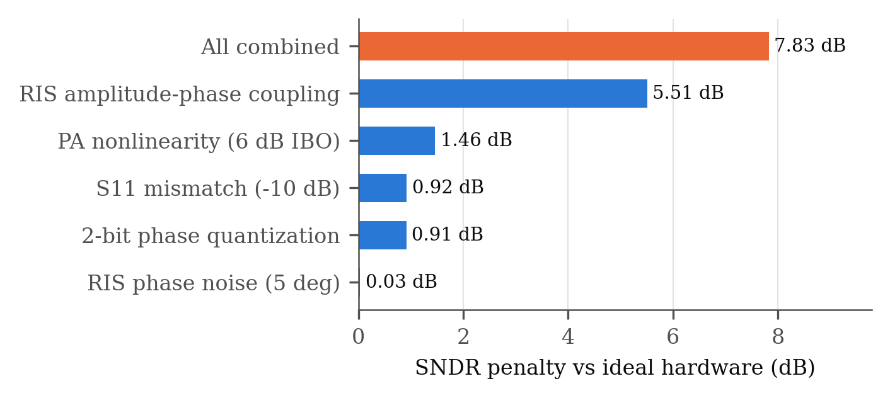
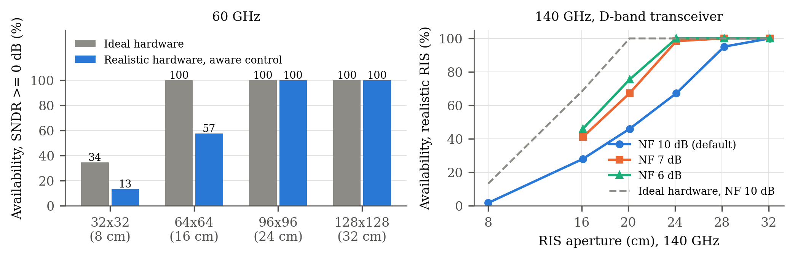
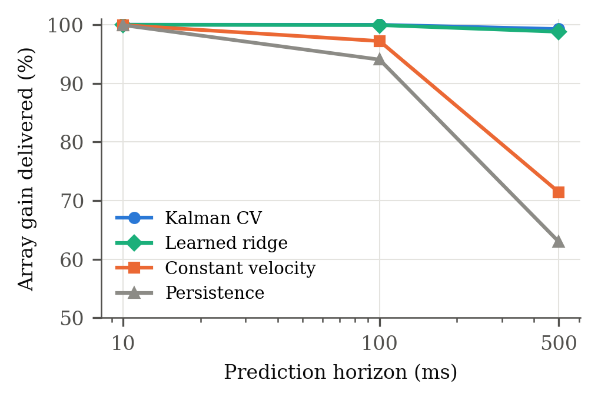
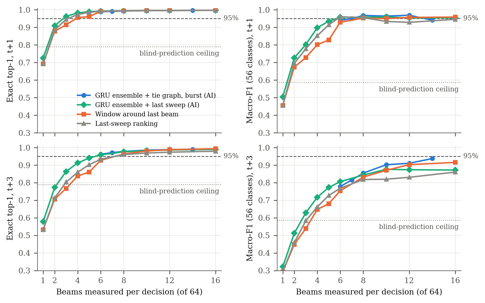

# Hardware-Aware AI-Assisted Beam Training, Tracking, and Channel Estimation for RIS-Assisted mmWave UAV Links

*Revised draft v3 (2026-10-30). Every number below is produced by the scripts in this repository; the
section "Reproducing this paper" at the end maps each table and figure to its script. Items marked
**[VERIFY]** need the author's confirmation before submission.*

**Maavia**, Department of Computer Science, Institute of Space Technology (IST), Islamabad, Pakistan

---

## Abstract

Millimetre-wave (mmWave) and sub-terahertz links can give unmanned aerial vehicles (UAVs) multi-gigabit
connectivity, but narrow beams, high path loss and UAV mobility make beam management costly, and
practical hardware departs from the ideal models most reconfigurable intelligent surface (RIS) studies
assume. We present a hardware-aware framework for an RIS-assisted 60 GHz UAV link that models
transmitter power-amplifier (PA) distortion through the Bussgang decomposition, RIS phase quantization,
phase noise, amplitude–phase coupling and antenna mismatch, together with ITU-R P.676-13 gaseous
absorption. On this model we show that (i) impairments cost 7.8 dB of SNDR, dominated by amplitude–phase
coupling, so a realistic RIS needs about 2.25× more elements than an ideal one for full coverage of a
300 m flight; (ii) a position-parametric channel estimator reaches within 0.15 dB of perfect channel
knowledge with 64× fewer pilots than per-element LMMSE, and needs no pilots when a 100 ms Kalman
prediction is available; and (iii) predictive tracking delivers 99.3% of the ideal array gain at 500 ms
latency, whereas persistence delivers 63%. On real 60 GHz measurements (DeepSense 6G Scenario 23) we
show that exact blind beam prediction is bounded at 79% top-1 by measurement noise, and propose an
AI-assisted reduced beam training scheme with a learned beam-tie graph. Given full-sweep history it
selects the exact optimal beam 99.3% of the time at a 140 ms horizon (macro-F1 0.961 over all 56 beam
classes) and 99.1% at 0.4 s. Replayed in closed loop, where the system knows only the beams it measured,
tie-graph tracking selects the exact optimal beam 97.2% of the time (99.2% within measurement noise)
with 1.05 ms of beam training per decision instead of 5 ms, under sequence-level cross-validation.

**Index Terms**: mmWave, sub-THz, UAV, reconfigurable intelligent surface, beam training, beam
tracking, channel estimation, hardware impairments, deep learning.

---

## I. Introduction

Sixth-generation (6G) systems target mmWave and sub-THz bands for their large bandwidths [1], [2].
UAVs benefit directly, as aerial base stations, relays and sensing platforms, but high-frequency links
depend on narrow beams that a moving UAV quickly leaves. Exhaustive beam sweeping costs time that a
fast link cannot spare, which has motivated learning-based beam prediction from position and vision
[3], [4]. Reconfigurable intelligent surfaces (RISs) add a programmable reflection path when the direct
link is blocked [14], but real RIS hardware and transceivers are not ideal: transceiver distortion and
RIS phase noise change both performance and the optimal configuration [5], [6], and a practical RIS
element couples its reflection amplitude to its phase [15].

Three gaps motivate this work. First, RIS–UAV studies often pair idealised hardware with idealised
link budgets, which hides the hardware cost. Second, phase-tracking studies frequently score
controllers by per-element phase error, a metric that, as we show, says nothing about received power.
Third, beam prediction results on public datasets are easy to overstate: in the dataset we use, the
ground-truth beam is the argmax of the same power sweep often used as input, and consecutive samples
are nearly identical, so random splits leak.

**Contributions.**

1. A hardware-aware RIS–UAV link model with transmitter PA distortion (Bussgang SNDR), RIS phase
   quantization, phase noise, amplitude–phase coupling and S11 mismatch, on a full ITU-R P.676-13
   absorption model, with an impairment ablation and an RIS sizing rule (Sec. II, VI-A).
2. Hardware-aware control and estimation: a coupling-aware discrete phase search, an LMMSE estimator
   that inverts the hardware's realised training patterns, and a position-parametric estimator with an
   adaptive pilot budget (Sec. III, VI-B).
3. A predictive tracking study scored by delivered array gain, showing that position-based RIS control
   works at realistic sensor precision once the right metric is used (Sec. IV, VI-C).
4. On real 60 GHz measurements, a proof that exact blind beam prediction is noise-limited, a GRU trained
   on a soft power target, a learned beam-tie graph, and an AI-assisted reduced beam training scheme
   meeting ≥ 95% exact top-1 and macro-F1, conformal shortlists calibrated to a target accuracy, and a
   closed-loop replay of every flight in which the system knows only what it measured, evaluated with
   sequence-level cross-validation and bootstrap confidence intervals (Sec. V, VI-D).

---

## II. System Model

### A. Geometry

A fixed base station (BS) at (25, −15, 10) m serves a UAV through an N-element RIS whose direct path is
blocked. The RIS is a 32×32 uniform planar array with λ/2 spacing (8 cm aperture at 60 GHz), mounted on
a facade at (0, 0, 20) m with outward normal +x; it serves only the half-space in front of it. The UAV
flies at 10 m/s; trajectories cover straight, diagonal, climbing, descending, circular, helical and
waypoint paths, all in front of the panel.

### B. Channel

For element n at distance d, the BS→RIS and RIS→UAV coefficients are

h₁[n] = √G_BS · (λ / 4πd₁ₙ) · e^(−j2πd₁ₙ/λ)   · a(d₁ₙ) · √(G_e cos^q θ₁ₙ),   (1)

and likewise h₂[n] with the UAV gain G_UAV, where a(d) = 10^(−γd/20) is the gaseous-absorption amplitude
with γ from the ITU-R P.676-13 line-by-line model (44 O₂ and 35 H₂O lines) at 1013.25 hPa, 288.15 K and
7.5 g/m³ [8]; γ = 14.6 dB/km at 60 GHz. G_e = π is the gain of a (λ/2)² element [16], θ is measured
from the panel normal, q = 1.5, and the pattern is zero behind the panel. G_BS = 25 dBi and
G_UAV = 10 dBi; the transmit power is 20 dBm and the receiver noise is kTB·NF = −87 dBm (B = 100 MHz,
NF = 7 dB).

The received signal with reflection coefficients Γₙ is

y = Σₙ h₂[n] Γₙ h₁[n] · x + w.   (2)

With ideal hardware the optimal phases are φₙ = −∠(h₁[n] h₂[n]) and the array gain grows as N²
(verified: +12.04 dB per quadrupling of N).

### C. Hardware Impairments

**Transmitter PA.** A passive RIS has no amplifier; the PA sits at the BS. We apply Saleh's AM/AM and
AM/PM model [9] (α = 2.1587, β = 1.1517, α_φ = 4.0033, β_φ = 9.1040) to a complex Gaussian (OFDM-like)
input at 6 dB input back-off. By the Bussgang decomposition [17] the output is K·x + d, with d
uncorrelated with x, so a fraction ρ_d of the output power is distortion that travels through the
channel with the signal [18]:

SNDR = ρ_u P|h|² / (ρ_d P|h|² + σ²).   (3)

At 6 dB back-off ρ_u/ρ_d gives an SNDR ceiling of 13.3 dB, independent of link strength.

**RIS.** Commanded phases are quantized to b = 2 bits, perturbed by Gaussian phase noise (σ = 5°), and
realised with the phase-dependent amplitude of a practical element [15]:

β(φ) = (1 − β_min) · ((sin(φ − ϕ) + 1)/2)^κ + β_min,   β_min = 0.2, ϕ = 0.43π, κ = 1.6,   (4)

scaled by a reflection efficiency of 0.85.

**Antenna mismatch.** S11 = −10 dB at the BS and UAV ports gives a power transfer of 1 − |S11|² each.

Each impairment is switchable, so ideal and hardware-aware links are compared on identical geometry.

---

## III. Hardware-Aware Control and Channel Estimation

### A. Coupling-Aware Phase Selection

Because (4) ties amplitude to phase, the ideal phases are no longer optimal. For a common output phase ψ
the best realisable level for element n maximises Re(cₙ Γ(level) e^(−jψ)), with cₙ = h₁[n]h₂[n]; we
sweep 64 values of ψ and keep the best. The search is fully vectorised (≈3 ms for N = 1024).

### B. Per-Element Estimation: LS vs Hardware-Aware LMMSE

The RIS cycles through N Hadamard training patterns, each held for L pilot symbols. The *naive* LS
estimator assumes the commanded 0/π states were realised exactly. Under (4) the two states have
amplitudes 0.19 and 0.91, which biases LS. The *hardware-aware* estimator trains on the antipodal state
pair with the largest reflected energy, models the realised coefficients through (4), and applies
LMMSE with an i.i.d. prior; because PA distortion is signal-dependent, only its average power enters the
noise model.

### C. Position-Parametric Estimation

The BS and RIS are fixed, so c(p) = h₁ ⊙ h₂(p) depends only on the UAV position p. Beyond the Fresnel
distance (≈5 m here) the pilots constrain the direction of p sharply and its range weakly. Starting from
a prior p₀, the RIS transmits M random realisable patterns A, and the receiver estimates the direction
by maximising the likelihood under an unknown complex gain,

p̂ = argmax_p |yᴴ A c(p)|² / ‖A c(p)‖²,   (5)

over direction cosines on a coarse grid finer than the beam width, then a fine grid. The RIS is then
configured from c(p̂) with the search of Sec. III-A.

**Adaptive pilot budget.** The search succeeds when the matched-filter pilot SNR M·L·SNR_coh/N exceeds a
threshold; SNR_coh is predicted from p₀ and the known geometry. With M = 64 we choose L to reach a
threshold of 128, selected on random seeds separate from those reported. If the prior's angular
uncertainty is already below one eighth of the beam width, no pilots are sent.

---

## IV. Predictive RIS Tracking

The RIS must be configured for where the UAV will be once measurement, computation and control latency
have passed. We predict the position h steps ahead (h·10 ms, h ∈ {1, 10, 50}) from RTK-class position
measurements (σ = 2 cm per axis) with four predictors: persistence, constant-velocity extrapolation, a
constant-velocity Kalman filter [13] whose acceleration PSD is tuned on training trajectories, and a
ridge regressor on an 8-sample window trained on 60 random trajectories. All predictors see the same
noisy measurements, and the nine designed trajectories are held out.

**Metric.** Mean absolute per-element phase error counts a phase offset common to all elements as error,
but such an offset leaves |Σₙ cₙ e^(jφ̂ₙ)| unchanged. We therefore score the fraction of the ideal
coherent gain delivered at the true position:

G = |Σₙ cₙ e^(jφ̂ₙ)|² / (Σₙ |cₙ|)².   (6)

---

## V. AI Beam Prediction on Real Measurements

### A. Dataset and Evaluation Protocol

DeepSense 6G Scenario 23 [10] provides 11,387 samples of 64-beam received-power sweeps at 60 GHz from a
drone flight campaign, organised into 35 flight sequences, with the optimal-beam index as label (56
classes in use). Three properties of the data shape the protocol:

1. **The label is the argmax of the sweep** for all 11,387 samples, so predicting the current beam from
   the current sweep is trivial (100% by argmax). Every task below predicts the beam at time t + h from
   sweeps up to time t.
2. **Consecutive samples are near-duplicates** (≈7 Hz). All models are evaluated with GroupKFold(5)
   over flight sequences, so a test sequence is never seen in training.
3. **Near-ties are noise.** In 75.3% of sweeps the best and second-best beams are within 0.25 dB (they
   are adjacent in 90.6%), while the same beam's power changes by a median 0.18 dB between consecutive
   sweeps.

### B. Blind Prediction

A two-layer GRU (hidden size 128) reads the last 8 sweeps (dB relative to peak) and the sampling gaps,
and outputs beam logits added to a learned multiple of the last sweep, so that it learns a residual over
persistence. Because near-tied labels are noise, we train against a **soft target**,
softmax(P_{t+h}/0.5 dB), the measured power of the future sweep, rather than its argmax; a hard-label GRU
is the ablation. Early stopping uses held-out training sequences. Our final predictor averages the
log-probabilities of three such GRUs (different seeds) trained with **beam-axis augmentation**: each
batch is shifted by up to ±3 beams and mirrored with probability 0.5, identically for history, last
sweep and target, with vacated edge beams set to the row's floor rather than wrapped. A UAV at a slightly
different angle sees a shifted beam pattern, so this adds plausible examples of rarely visited beams.
Random-forest and extra-trees baselines use the last 3 sweeps.

**Noise ceiling.** As an upper bound for any causal predictor of the exact label, a non-causal oracle
that averages the sweeps *before and after* the target sweep reaches only **79.0% exact top-1 and 0.59
macro-F1**.

### C. AI-Assisted Reduced Beam Training

A deployed link does not have to choose blind: it can measure a few candidate beams at time t + h and
keep the strongest. The predictor ranks the beams; the system measures the top K and keeps the best;
the result is scored against the **full 64-beam ground truth** on exact top-1 and macro-F1, with an
overhead of K/64 of a full sweep. Shortlists are produced from out-of-fold GRU scores and compared with
non-learned rankings (the last sweep's strongest beams; a window around the last best beam). The fused
ranking adds the z-scored GRU log-probabilities to the z-scored last sweep with equal weight. An
adaptive variant measures the smallest set whose GRU probability reaches τ.

**Learned tie graph.** The strong beams of this codebook are not contiguous: beams 27, 28, 32, 33 and 38
are often within 0.1 dB of each other, so a search around the last best beam misses the true best. For
each beam b, the training flights give the beams most often within 1 dB of the best when b was the best.
Two schemes use it, following the coarse/refine split of 3GPP beam management. *Two-round*: measure the
first K₁ ranked beams, then the M top graph partners of the measured winner; if the best measured power
is still more than 3 dB below the last sweep's peak, the beam is treated as lost and the remaining beams
are swept. *Burst*: append the graph partners of the two *predicted* best beams to the first K ranked
beams and measure them all at once, avoiding a report round trip.

**Latency model.** We use 5G NR FR2 timing at 120 kHz subcarrier spacing, where up to 64 SSB beams fit in
a 5 ms half-frame [22]: 78 µs per beam measurement, plus 1 ms for each extra report round trip. A full
sweep costs 5 ms. GRU inference (0.5 ms for one model and 1.4 ms for the 3-model ensemble at batch size 1
on a laptop CPU) is not on the critical path: the shortlist for t + h is computed from sweep t, during
the ≈140 ms before t + h.

**Operating points by nested cross-validation.** For each held-out fold, the setting (K, τ, or K₁, M and
the fallback) is the lowest-latency one meeting 95% on both exact top-1 and all-class macro-F1 over the
other four folds, and is then applied unchanged to the held-out fold. The tie graph is always fitted on
folds other than those it is scored on, including inside this selection. 95% confidence intervals come
from 500 bootstrap resamples of whole flight sequences.

**Conformal shortlists.** A measured set returns the exact optimal beam if and only if that beam is in
the set, so set coverage equals exact top-1. We calibrate the set size by split conformal prediction
[23]: on four folds, the score is the true beam's rank in the GRU ranking, and the threshold is its
⌈(n + 1)(1 − α)⌉-th smallest value; the fifth fold is the test. Adaptive prediction sets [24] use the
GRU's cumulative probability instead. Samples within a flight are correlated and flights differ, so the
exchangeability behind the guarantee holds only approximately; we report the coverage of every held-out
fold.

**Closed-loop replay.** The schemes above build each shortlist from full sweeps of earlier steps, which
a system measuring only K beams per step never has. We therefore replay every flight step by step with
policies that know only the beams they measured: the current beam, its ±1 index neighbours and its M
strongest tie-graph partners (fitted on other folds' flights), with a full sweep every N steps or only
on beam loss (best measured power more than 3 dB below the current beam's last value). The effective
spectral efficiency over each interval is (1 − T_train/T) times the mean of log2(1 + SNR₀ p_used/p_best)
at the interval's start and end, using measured powers, so beam ageing is measured, not modelled. The
dataset's powers are unitless, so SNR₀, the best beam's SNR, is a nominal operating point.

---

## VI. Results

### A. Link Budget and Hardware Impairments

With ideal hardware the SNR is 15.8 dB at 20 m and 8.8 dB at 50 m. At 50 m the combined impairments cost
**7.83 dB** (Fig. 1): amplitude–phase coupling 5.51 dB, PA nonlinearity 1.46 dB, S11 mismatch 0.92 dB,
2-bit quantization 0.91 dB and phase noise 0.03 dB.

*Fig. 1. SNDR penalty of each impairment alone and combined, UAV at 50 m.*

**Note on the first draft.** Without antenna and element gains and with an 8×8 (2 cm) RIS, the SNR is
−43.2 dB at 20 m, the value reported in our earlier draft; it reflects missing gains, not sub-THz
propagation. The same cause explains the earlier −170 dBm at 140 GHz: with gains included, an 8×8 RIS
receives −115.9 dBm at 140 GHz at 50 m, and the N² law holds at both carriers (Table I).

*Table I. Received power at 50 m, ideal hardware (dBm).*

| RIS | 60 GHz | 140 GHz |
|---|---|---|
| 8×8 | −102.3 | −115.9 |
| 16×16 | −90.2 | −103.8 |
| 32×32 | −78.2 | −91.8 |
| 64×64 | −66.2 | −79.7 |

**Phase resolution and coupling strength.** Coupling-aware selection (Sec. III-A) gains more as more
realisable states become available: 0.55, 0.92 and 1.01 dB at 2, 3 and 4 bits, and nothing at 1 bit
(−0.06 dB). No measured coupling curve for a 60 GHz element is available to us, so we sweep its strength
(Table II). The total penalty ranges from 2.9 dB without coupling to 7.8 dB at β_min = 0.2; the
conclusions below hold across this range, and the gain of coupling-aware control shrinks as coupling
weakens.

*Table II. SNDR penalty vs coupling strength, UAV at 50 m, 2-bit phases.*

| β_min | 0.2 | 0.4 | 0.6 | 0.8 | 1.0 (none) |
|---|---|---|---|---|---|
| Naive control (dB) | 7.83 | 6.22 | 4.92 | 3.84 | 2.93 |
| Coupling-aware (dB) | 7.28 | 5.98 | 4.83 | 3.80 | 2.90 |

Impairments change how large the RIS must be (Fig. 2). Over a 20 → 320 m flight, a 64×64 RIS gives 100%
availability (SNDR ≥ 0 dB) with ideal hardware but only 57% with realistic hardware; a 96×96 RIS
(24 cm) restores 100%. The hardware cost is therefore about 2.25× in element count.

*Fig. 2. Link availability over the flight versus RIS size.*

**60 vs 140 GHz at equal aperture.** With the same 8 cm panel (32×32 at 60 GHz, 75×75 at 140 GHz) and the
same transceiver hardware, 140 GHz performs slightly better (ideal SNR 16.6 vs 15.8 dB at 20 m; 47.5% vs
34.4% availability): it avoids the 60 GHz oxygen line (0.69 vs 14.6 dB/km) and fits 5.5× more elements in
the same area. With published D-band hardware (about 20 dBm PA saturation [20], hence 14 dBm average at
6 dB back-off, and an LNA noise figure near 10 dB [21]) the link loses about 9 dB, and the RIS must grow
to 32 cm (300×300 elements) for full availability with realistic impairments, against 24 cm at 60 GHz
(Table III). At sub-THz, transceiver hardware, not propagation, sets the RIS size.

*Table III. Availability (%) over the flight, 140 GHz with D-band hardware, ideal / realistic RIS.*

| RIS (aperture) | 75×75 (8 cm) | 150×150 (16 cm) | 225×225 (24 cm) | 300×300 (32 cm) |
|---|---|---|---|---|
| Ideal hardware | 13.1 | 68.9 | 100 | 100 |
| Realistic, coupling-aware | 1.6 | 27.9 | 67.2 | 100 |

### B. Channel Estimation

Naive LS saturates at about −7.5 dB NMSE because of the coupling bias, whereas hardware-aware LMMSE keeps
improving with pilot length (−11.1 dB at 20 m with 4096 symbols per pattern) and is never worse. In
closed loop (estimate, configure, measure SNDR), the hardware-aware pipeline beats the naive one at
every distance and pilot length, by 0.4–1.2 dB.

Per-element estimation, however, scales poorly with range. The parametric estimator (Table IV) reaches
perfect-CSI SNDR to within 0.15 dB at 20–100 m with 64×1024 = 65k pilot symbols, against 4.2M for
per-element LMMSE, which still falls 1.6 dB short at 100 m. A 5 m GPS prior alone is useless
(−23 to −31 dB) because its error exceeds the beam width. With the adaptive budget (Table V), the
estimator delivers 96.5–100% of perfect-CSI SNR on average at every range and prior, and needs no pilots
when the 100 ms Kalman prediction is used as prior.

*Table IV. SNDR (dB) from a 5 m GPS prior.*

| UAV at | Perfect CSI | GPS only | Parametric, 65k pilots | Per-element LMMSE, 4.2M pilots |
|---|---|---|---|---|
| 20 m | 7.47 | −23.7 | 7.47 | 7.32 |
| 50 m | 1.50 | −31.4 | 1.49 | 1.07 |
| 100 m | −4.75 | −22.9 | −4.90 | −6.33 |

*Table V. Adaptive parametric estimation: mean (worst of 10) % of perfect-CSI SNR, and pilot symbols.*

| UAV at | GPS prior (5 m) | Kalman, 500 ms (31 cm) | Kalman, 100 ms (5 cm) |
|---|---|---|---|
| 20 m | 97.4 (90.9), 6k | 97.3 (93.4), 4k | 99.5 (98.6), 0 |
| 50 m | 98.4 (95.9), 31k | 98.5 (95.8), 33k | 99.9 (99.4), 0 |
| 100 m | 96.9 (93.5), 131k | 96.8 (91.7), 131k | 99.9 (99.6), 0 |
| 200 m | 96.5 (86.3), 524k | 99.4 (98.5), 0 | 100.0 (99.8), 0 |

### C. Predictive Tracking

Every predictor shows a mean absolute phase error of 89–92°, the value an unaligned phase profile would
give, yet the delivered gain (6) ranges from 63% to 100% (Table VI, Fig. 3). The phase-error metric
therefore cannot rank controllers. Prediction matters at realistic latencies: at 500 ms the Kalman
filter delivers 99.3% of the ideal gain (5th percentile 97.4%), the learned ridge predictor 98.8%,
constant velocity 71.4% and persistence 63.0%. All predictors run in under 0.1 ms per step.

*Table VI. Delivered array gain (%) and position RMSE (cm), held-out trajectories.*

| Horizon | Persistence | Constant velocity | Kalman CV | Ridge (learned) |
|---|---|---|---|---|
| 10 ms | 99.9 / 10.4 | 99.9 / 7.7 | **100.0 / 2.0** | 100.0 / 2.7 |
| 100 ms | 94.0 / 97.9 | 97.2 / 51.9 | **99.98 / 5.2** | 99.9 / 8.2 |
| 500 ms | 63.0 / 488 | 71.4 / 250 | **99.3 / 30.7** | 98.8 / 41.4 |

*Fig. 3. Delivered array gain versus prediction horizon.*

### D. Beam Prediction on Scenario 23

**Blind prediction** (Table VII). At t + 1 (≈140 ms) the augmented GRU ensemble selects a beam within the
0.25 dB noise margin 96.4% of the time (class-balanced 91.7%), has 96.1% top-3 accuracy, and delivers
99.1% of the optimal received power. Its exact top-1 is 72.1% against the 79.0% oracle ceiling. At t + 3
it reaches 86.0% within noise and 96.8% power ratio. Trained on hard labels, a single GRU falls below
persistence at t + 3; the soft target makes it competitive, and augmentation with ensembling makes it
the best model on every metric at both horizons, including blind macro-F1 at t + 3 (0.28 vs 0.26).

*Table VII. Blind beam prediction, GroupKFold over 35 sequences.*

| Horizon | Model | Within noise | Balanced within noise | Top-3 | Power ratio | Exact top-1 | Macro-F1 |
|---|---|---|---|---|---|---|---|
| t+1 | Persistence | 93.7 | 86.3 | 94.5 | 98.6 | 69.2 | 0.45 |
| t+1 | RF + sweep prior | 93.7 | 86.7 | 94.9 | 98.6 | 70.4 | 0.41 |
| t+1 | GRU, hard label | 93.7 | 82.3 | 94.6 | 98.6 | 70.9 | 0.41 |
| t+1 | GRU, soft target | 95.6 | 89.3 | 95.1 | 98.9 | 70.9 | 0.45 |
| t+1 | **GRU ensemble, augmented** | **96.4** | **91.7** | **96.1** | **99.1** | **72.1** | **0.49** |
| t+3 | Persistence | 78.1 | 66.1 | 80.3 | 93.7 | 53.3 | 0.26 |
| t+3 | GRU, hard label | 73.2 | 57.9 | 80.6 | 93.1 | 49.5 | 0.21 |
| t+3 | GRU, soft target | 81.1 | 65.8 | 84.8 | 95.5 | 55.3 | 0.24 |
| t+3 | **GRU ensemble, augmented** | **86.0** | **75.5** | **86.9** | **96.8** | **56.7** | **0.28** |

**Reduced beam training** (Table VIII, Fig. 4). Measuring a handful of predicted beams resolves the
near-ties that blind prediction cannot. At t + 1, the GRU ensemble with the tie graph selects the exact
optimal beam 99.3% of the time with macro-F1 0.961 over all 56 classes, measuring 7 of 64 beams in
0.55 ms; the 95% interval of exact top-1 lies above 95%. At t + 3, the same scheme reaches 99.1% exact
top-1 and macro-F1 0.974 over beams with at least five samples, with 11.7 beams. The single-burst
variant reaches 98.9% / 0.971 in 1.22 ms. Every scheme in Table VIII also keeps at least 99.5% of
decisions within the 0.25 dB noise floor and at least 99.8% of the best beam's power.

*Table VIII. Reduced beam training (open-loop: full-sweep history assumed), nested-CV operating points,
scored against the full-sweep ground truth [95% CI over sequences]. Latency: beam-training time under 5G NR FR2 timing (full sweep: 5 ms).
Macro-F1 ≥ 5: over beam classes with at least five samples.*

| Horizon | Shortlist | Beams | Latency (ms) | Exact top-1 (%) | Macro-F1 (56 classes) | Macro-F1 ≥ 5 |
|---|---|---|---|---|---|---|
| t+1 | Last sweep, K = 4 (85% target) | 4.2 | 0.33 | 97.6 [96.4, 98.5] | 0.871 [0.829, 0.912] | 0.945 |
| t+1 | Last sweep, K = 6 | 6.0 | 0.47 | 99.1 [98.6, 99.5] | 0.960 [0.940, 0.985] | 0.981 |
| t+1 | **GRU ensemble + tie graph, two-round** | **7.0** | **0.55** | **99.3 [98.7, 99.7]** | **0.961 [0.941, 0.990]** | **0.985** |
| t+1 | GRU ensemble + last sweep, burst | 6.4 | 0.50 | 99.2 [98.7, 99.6] | 0.955 [0.940, 0.977] | 0.984 |
| t+3 | Last sweep, K = 16 | 16.0 | 1.25 | 97.9 [96.6, 98.8] | 0.860 [0.823, 0.906] | 0.956 |
| t+3 | GRU ensemble, single round | 15.2 | 1.19 | 98.9 [98.0, 99.5] | 0.896 [0.864, 0.944] | 0.965 |
| t+3 | Last sweep + tie graph, two-round | 13.9 | 2.11 | 99.4 [98.9, 99.7] | 0.914 [0.889, 0.956] | 0.979 |
| t+3 | **GRU ensemble + tie graph, two-round** | **11.7** | **1.93** | **99.1 [98.3, 99.7]** | **0.929 [0.905, 0.964]** | **0.974** |
| t+3 | GRU ensemble + tie graph, burst | 15.6 | 1.22 | 98.9 [98.1, 99.6] | 0.912 [0.880, 0.949] | 0.971 |

*Fig. 4. Exact top-1 (left) and all-class macro-F1 (right) versus beams measured at t + 1 (top) and
t + 3 (bottom), out-of-fold predictions; dashed: 95% target; dotted: non-causal blind-prediction
ceiling.*

Raising the target from 85% to 95% costs 2–3 more beams at t + 1, still under 0.6 ms. At this horizon
a non-learned 6-beam shortlist also meets the target, so the learned ranking adds little. The tie graph
and the GRU matter at t + 3: all-class macro-F1 rises from 0.860 (last sweep, 16 beams) to 0.929 with
11.7 beams, and the GRU ensemble needs 16% fewer beams than the last-sweep ranking with the same graph.
At t + 3, all-class macro-F1 stays below 0.95, and the reason is identifiable: three beams (23, 34 and
55) occur once in the whole dataset, and in each case the best beam beats the runner-up by about 0.01 dB.
Each such class costs 1/56 ≈ 0.018 of macro-F1. Over classes with at least five samples, every t + 3
scheme with the tie graph exceeds 0.97. Pooled curves reach 0.95 all-class with 16–18 beams, but
settings selected on four folds do not hold it on the fifth, so we report the nested values.

**Conformal shortlists.** Calibrated for 95% exact top-1, the rank-based set reaches 96.1% with 3 beams
at t + 1 (worst held-out fold 95.3%) and 95.5% with 5.4 beams at t + 3 (worst fold 92.7%); for a 99%
target, 99.2% with 6.2 beams and 99.0% with 17.4 beams. Coverage tracks the target on average, but a
single flight group can fall short by up to 2.3 points, which is the cost of non-exchangeable flights.
Adaptive sets over-cover (98.8% for a 95% target at t + 1) with a 95th-percentile size of 41–56 beams,
which is worse for worst-case latency.

**Closed loop** (Table IX). Without full-sweep history, a ±1 window with loss-triggered sweeps finds the
exact beam only 75.5% of the time; adding six tie-graph partners raises this to 96.1% at 0.64 ms per
decision. With a full sweep every 8 steps, tie-graph tracking reaches 97.2% exact top-1 and 99.2% within
noise at 1.05 ms. At the testbed's 142 ms step a full sweep takes only 3.5% of the airtime, so effective
spectral efficiency rises modestly, from 96.5% of the genie to 99.0–99.2%; the main gain is the 5× lower
beam-training latency per decision.

*Table IX. Closed-loop replay of all 35 flights (each policy knows only what it measured). Latency:
mean beam-training time per decision. SE: effective spectral efficiency as % of a genie that always
uses the best beam with no training time, at nominal best-beam SNR of 0 / 10 / 20 dB.*

| Policy | Exact top-1 (%) | Within noise (%) | Latency (ms) | SE (% of genie) |
|---|---|---|---|---|
| Full sweep every step | 100 | 100 | 5.00 | 96.5 / 96.5 / 96.5 |
| Window ±1, full sweep every 4 | 91.2 | 96.4 | 1.50 | 98.2 / 98.5 / 98.7 |
| Window ±1 + 4 tie partners, full every 4 | **97.8** | **99.4** | 1.61 | 98.7 / 98.8 / 98.8 |
| **Window ±1 + 4 tie partners, full every 8** | **97.2** | **99.2** | **1.05** | **99.0 / 99.1 / 99.2** |
| Window ±1, loss-triggered sweeps only | 75.5 | 83.2 | 0.35 | 92.9 / 95.0 / 96.8 |
| Window ±1 + 6 tie partners, loss-triggered only | 96.1 | 96.9 | 0.64 | 98.5 / 98.9 / 99.2 |

---

## VII. Discussion

**Metrics shape conclusions.** Two conclusions of our earlier draft reversed under correct metrics. A
Random Forest reported at 80.9% on the current-beam task was below the 100% that argmax achieves, and
"open-loop phase tracking is impossible at sub-THz" followed from per-element phase error, which is
blind to the common phase offset. We recommend that RIS tracking studies report delivered gain and that
beam-prediction studies on argmax-labelled data predict future beams under sequence-level splits.

**Where hardware awareness pays.** The largest impairment is amplitude–phase coupling. Coupling-aware
control recovers 0.55 dB at 2 bits and about 1 dB at 3–4 bits; a coupled element cannot reflect strongly
at every phase, so a gap remains. The estimation side gains more (LMMSE removes the coupling bias), and
the largest system-level effects are the RIS sizes needed for coverage: 2.25× the ideal element count at
60 GHz, and a 32 cm panel at 140 GHz once D-band transceiver limits are included.

**Learning where it helps.** On power sweeps alone the learned gain over persistence is modest at t + 1
and clear at t + 3 (86.0% vs 78.1% within noise). In reduced beam training, the largest single gain
comes from a simple learned structure, the beam-tie graph, rather than from the sequence model. The GRU
then reduces the beams measured at t + 3. In closed loop the GRU cannot yet be used, because it expects
full-sweep history; a sequence model trained on the sparse measurements a tracker actually has is the
natural next step. The soft
target and beam-axis augmentation matter more than the architecture. Logit adjustment for the class
imbalance [19] lowered every metric because the beam distribution differs between flights.

**Limitations.** Saleh and coupling coefficients are literature values, not measurements of a 60 GHz
PA or RIS; Table II bounds the effect of the coupling strength. The obliquity exponent is assumed. The physical-layer results are simulated; the
beam-prediction results use power sweeps only, because the UAV GPS files of Scenario 23 were not
available to us at the time of writing. The all-class macro-F1 at t + 3 (0.929) is limited by beams
seen only once; more flights, not a different model, are needed to estimate it reliably. The latency
model uses standard 5G NR FR2 timing, not the testbed's own sweep timing. The Table VIII figures are
open-loop (they assume full-sweep history); Table IX gives the closed-loop figures. Effective spectral
efficiency is reported at nominal SNRs because the dataset's powers are unitless. The D-band transceiver values are representative published figures, not a specific design.

---

## VIII. Conclusion

We built a hardware-aware model of an RIS-assisted mmWave UAV link and used it, with real 60 GHz
measurements, to evaluate beam management end to end. Hardware impairments cost 7.8 dB and 2.25× RIS
elements at 60 GHz, and D-band transceiver limits push the 140 GHz panel to 32 cm; a position-parametric
estimator matches perfect channel knowledge with 64× fewer pilots;
Kalman-based prediction preserves 99.3% of the array gain at 500 ms latency; and AI-assisted reduced beam
training with a learned beam-tie graph selects the exact optimal beam 99.3% of the time given full-sweep
history and 97.2% in a closed-loop replay of every flight, with 1.05 ms of beam training per decision
instead of 5 ms, with all reported metrics evaluated under sequence-level cross-validation. Future work will add UAV position to beam
prediction, measured hardware coefficients, and a sequence model trained on the sparse measurements of the
closed loop.

---

## References

[1] S. M. Shah *et al.*, "TeraHertz communication and associated challenges in 6G cellular networks,"
in *Proc. ICCIS*, 2021, doi: 10.1109/ICCIS54243.2021.9676382.

[2] C. Chaccour, M. N. Soorki, W. Saad, M. Bennis, P. Popovski, and M. Debbah, "Seven defining features
of terahertz (THz) wireless systems: A fellowship of communication and sensing," *IEEE Commun. Surveys
Tuts.*, vol. 24, no. 2, pp. 967–993, 2022. **[VERIFY: the first draft attributed this paper to
I. F. Akyildiz et al. in IEEE JSAC.]**

[3] G. Charan *et al.*, "Towards real-world 6G drone communication: Position and camera aided beam
prediction," in *Proc. IEEE GLOBECOM*, 2022, pp. 2951–2956.

[4] V. A. Nugroho and B. M. Lee, "GPS-aided deep learning for beam prediction and tracking in UAV mmWave
communication," *IEEE Access*, vol. 13, pp. 117065–117077, 2025.

[5] J. Dai, F. Zhu, C. Pan, H. Ren, and K. Wang, "Statistical CSI-based transmission design for
reconfigurable intelligent surface-aided massive MIMO systems with hardware impairments," *IEEE Wireless
Commun. Lett.*, vol. 11, no. 1, pp. 38–42, Jan. 2022.

[6] M. Meles, A. Rajasekaran, L. Mela, and R. Jäntti, "RIS-assisted three-dimensional drone localization
and tracking under hardware impairments," *IEEE Access*, vol. 12, pp. 81348–81361, 2024.

[7] **[VERIFY: authors missing]** "Fundamentals of wobbling and hardware impairments-aware air-to-ground
channel model," *IEEE Trans. Veh. Technol.*, vol. 73, no. 12, pp. 17946–17962, Dec. 2024.

[8] Recommendation ITU-R P.676-13, "Attenuation by atmospheric gases and related effects," ITU, 2022.

[9] A. A. M. Saleh, "Frequency-independent and frequency-dependent nonlinear models of TWT amplifiers,"
*IEEE Trans. Commun.*, vol. COM-29, no. 11, pp. 1715–1720, Nov. 1981.

[10] A. Alkhateeb *et al.*, "DeepSense 6G: A large-scale real-world multi-modal sensing and
communication dataset," *IEEE Commun. Mag.*, vol. 61, no. 9, pp. 122–128, Sep. 2023.

[11] L. Breiman, "Random forests," *Mach. Learn.*, vol. 45, no. 1, pp. 5–32, 2001.

[12] K. Cho *et al.*, "Learning phrase representations using RNN encoder-decoder for statistical machine
translation," in *Proc. EMNLP*, 2014.

[13] R. E. Kalman, "A new approach to linear filtering and prediction problems," *J. Basic Eng.*,
vol. 82, no. 1, pp. 35–45, 1960.

[14] Q. Wu and R. Zhang, "Towards smart and reconfigurable environment: Intelligent reflecting surface
aided wireless network," *IEEE Commun. Mag.*, vol. 58, no. 1, pp. 106–112, Jan. 2020.

[15] S. Abeywickrama, R. Zhang, Q. Wu, and C. Yuen, "Intelligent reflecting surface: Practical phase
shift model and beamforming optimization," *IEEE Trans. Commun.*, vol. 68, no. 9, pp. 5849–5863,
Sep. 2020.

[16] W. Tang *et al.*, "Wireless communications with reconfigurable intelligent surface: Path loss
modeling and experimental measurement," *IEEE Trans. Wireless Commun.*, vol. 20, no. 1, pp. 421–439,
Jan. 2021.

[17] J. J. Bussgang, "Crosscorrelation functions of amplitude-distorted Gaussian signals," MIT Research
Laboratory of Electronics, Tech. Rep. 216, 1952.

[18] E. Björnson, J. Hoydis, and L. Sanguinetti, "Massive MIMO networks: Spectral, energy, and hardware
efficiency," *Found. Trends Signal Process.*, vol. 11, no. 3–4, pp. 154–655, 2017.

[19] A. K. Menon *et al.*, "Long-tail learning via logit adjustment," in *Proc. ICLR*, 2021.

[20] A. S. H. Ahmed *et al.*, "A 140GHz power amplifier with 20.5dBm output power and 20.8% PAE in
250-nm InP HBT technology," in *Proc. IEEE IMS*, 2020. **[VERIFY author list]**

[21] **[VERIFY: cite a D-band (≈140 GHz) SiGe LNA with ≈10 dB noise figure; a 0.13 µm SiGe 5-stage
amplifier with NF down to 10 dB was found but its full citation needs checking.]**

[22] 3GPP TS 38.213, "NR; Physical layer procedures for control," Sec. 4.1 (SS/PBCH block candidate
positions, case D). **[VERIFY: release and version.]**

[23] A. N. Angelopoulos and S. Bates, "Conformal prediction: A gentle introduction," *Found. Trends Mach.
Learn.*, vol. 16, no. 4, pp. 494–591, 2023.

[24] Y. Romano, M. Sesia, and E. J. Candès, "Classification with valid and adaptive coverage," in *Proc.
NeurIPS*, 2020.

---

## Reproducing this paper

| Item | Script | Output |
|---|---|---|
| Sec. VI-A, Fig. 1–2, Tables I–III | `run_physical_layer.py` | `results/physical_layer_metrics.json` |
| Sec. VI-B, Tables IV–V | `run_physical_layer.py` (`parametric_study`, `adaptive_study`, `closed_loop_study`) | same |
| Sec. VI-C, Table VI, Fig. 3 | `tracking_eval.py` | `results/tracking_metrics.json` |
| Sec. VI-D, Table VII | `beam_prediction.py`, `beam_sequence_model.py` | `results/beam_*_metrics.csv` |
| Sec. VI-D, Table VIII, Fig. 4 | `beam_training_overhead.py` (after `beam_sequence_model.py`) | `results/beam_training_overhead.json` |
| Sec. VI-D, conformal shortlists | `conformal_beam_training.py` (after `beam_sequence_model.py`) | `results/conformal_beam_training.json` |
| Sec. VI-D, Table IX | `closed_loop_beam_tracking.py` | `results/closed_loop_beam_tracking.json` |
| All figures | `make_figures.py` | `paper/figures/` |
